# ND-110 Microcode Boot Process

## Overview

This document describes the complete boot process of the ND-110 minicomputer as implemented in microcode (`ND-110-RASK.uc`). The boot process starts from power-on/master clear and ends with the CPU executing loaded program code. There are two distinct loader paths depending on the device type selected via the ALD (Automatic Load Description) thumbwheel switch.

---

## Boot Flow — High Level

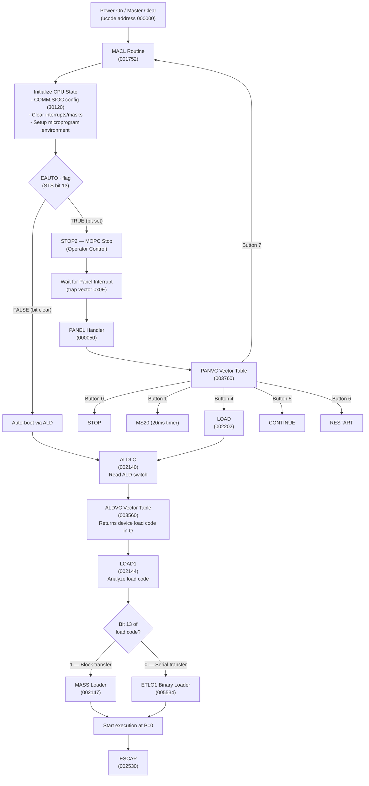

---

## Panel Vector Dispatch (PANVC)

When the operator presses a panel button, trap vector 0x0E fires. The microcode reads `IDBS,PANEL` to get the button code, loads it into the loop counter via `COMM,LDLC`, and dispatches through the PANVC table using `T,JMPAOPR`.

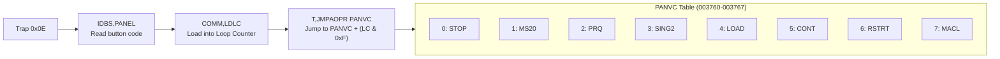

---

## ALD Device Selection (ALDVC)

The ALD thumbwheel on the CPU crate selects the boot device. ALDLO reads `IDBS,ALD`, loads the value into the loop counter, and dispatches through ALDVC. Each entry returns a device load code in the Q register.

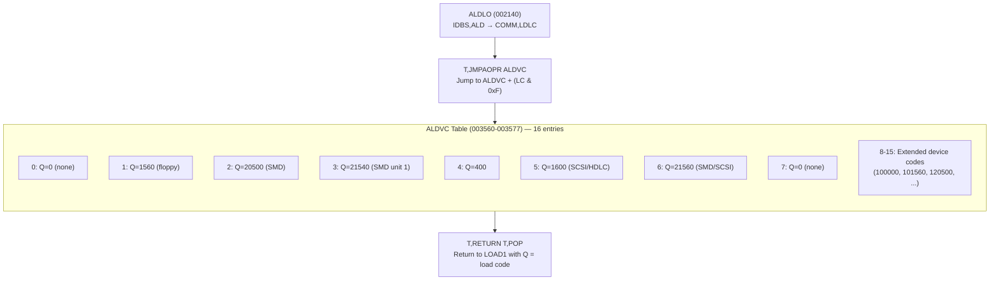

### ALDVC Load Code Table (all values in octal)

| ALD Position | Load Code | Bit 13 | Loader Path | Device Type |
|:---:|:---:|:---:|:---:|:---|
| 0 | 0 | — | None | No boot |
| 1 | 1560 | 0 | ETLO1 (serial) | Floppy |
| 2 | 20500 | 1 | MASS (block) | SMD disk |
| 3 | 21540 | 1 | MASS (block) | SMD unit 1 |
| 4 | 400 | 0 | ETLO1 (serial) | Serial device |
| 5 | 1600 | 0 | ETLO1 (serial) | SCSI / HDLC |
| 6 | 21560 | 1 | MASS (block) | SMD/SCSI block |
| 7 | 0 | — | None | No boot |
| 8 | 100000 | — | — | Extended |
| 9 | 101560 | 0 | ETLO1 (serial) | Extended floppy |
| 10 | 120500 | 1 | MASS (block) | Extended SMD |
| 11 | 121540 | 1 | MASS (block) | Extended SMD |
| 12 | 100400 | 0 | ETLO1 (serial) | Extended serial |
| 13 | 101600 | 0 | ETLO1 (serial) | Extended SCSI/HDLC |
| 14 | 121560 | 1 | MASS (block) | Extended block |
| 15 | 100000 | — | — | Extended |

---

## LOAD1 — Load Code Decision (002144)

LOAD1 receives the device load code in Q and determines which loader to use.

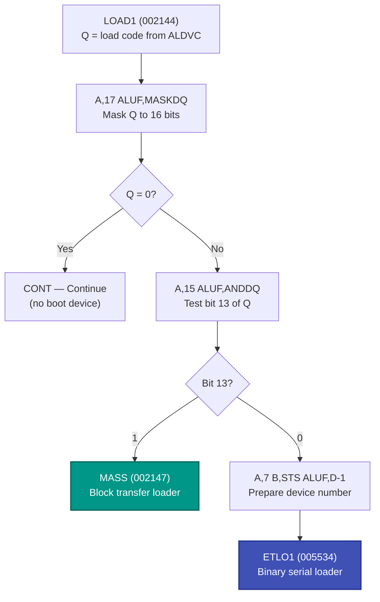

---

## MASS Storage Loader (002147) — Block Transfer

Used for **SMD-type disks** (load codes with bit 13 = 1). Performs DMA-style block transfer using IOX register offsets relative to device base address N. The sequence is **identical for all mass storage devices** — only N differs.

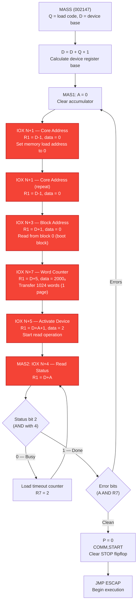

### MASS IOX Register Map

| IOX Offset | Address Calc | Data Sent | Purpose |
|:---:|:---|:---:|:---|
| N+1 | R1 = D - 1 | 0 | Core (memory) load address |
| N+1 | R1 = D - 1 | 0 | Core address (repeated) |
| N+3 | R1 = D + 1 | 0 | Block address on device (boot = block 0) |
| N+7 | R1 = D + 5 | 2000₈ | Word count for transfer (see note below) |
| N+5 | R1 = D + A + 1 | 2 | Activate device (start read) |
| N+4 | R1 = D + A | — | Read device status (poll loop) |

### Bootstrap Data Size

The microcode comment at line 5359 says `IOX N+7 (2000) WORD COUNTER`. The value 2000₈ = 1024 words = 2048 bytes = **1 SINTRAN page**.

Source: `ND-110-RASK.uc` line 5359 (comment), `PH-P2-OPPSTART.NPL` line 270 (page = 2000₈ words)

> **Note**: The instruction at line 5364 loads `A,12` (octal 12 = 10 decimal) into the ALU, but the comment explicitly says the value sent to the device is 2000₈. I cannot fully trace how the ALU datapath transforms 12₈ into 2000₈ — the comment is the primary evidence for the word count value.

This means the MASS bootstrap reads **disk page 0 (block 0) — exactly 1 page (1024 words / 2048 bytes) — into memory address 0**, then executes from address 0.

Source: `ND-30.003.007 EN SINTRAN III System Supervisor.md` lines 2923-2965:
- Disk Page 0 contains "BOOTSTRAP AND DIRECTORY ENTRY"
- "The bootstrap is read into physical memory by the ND-100 CPU, and is started"
- "The bootstrap program copies the SINTRAN IMAGE AREA to the MEMORY AREA"

The bootstrap in page 0 is a small standalone program. Once running, it uses the disk driver to load the full SINTRAN image from the SINTRAN IMAGE AREA on disk into memory.

### Status Polling

- **Bit 2** (mask = 4): Transfer complete flag. Loop until set.
- **Error bits**: Checked via AND with R7 after completion. On error, retry from MAS1.

### Start Address: 0 vs 20₈

The MASS loader **always starts at address 0**. The comment at line 5404 is explicit: `NO ERRORS, START IN 0, AND LEAVE NOPC`. Line 5406 sets P = 0 unconditionally.

Source: `ND-110-RASK.uc` lines 5404-5408

The decision between address 0 and 20₈ happens **before** the loader, in the ALD/restart path (lines 5449-5465):

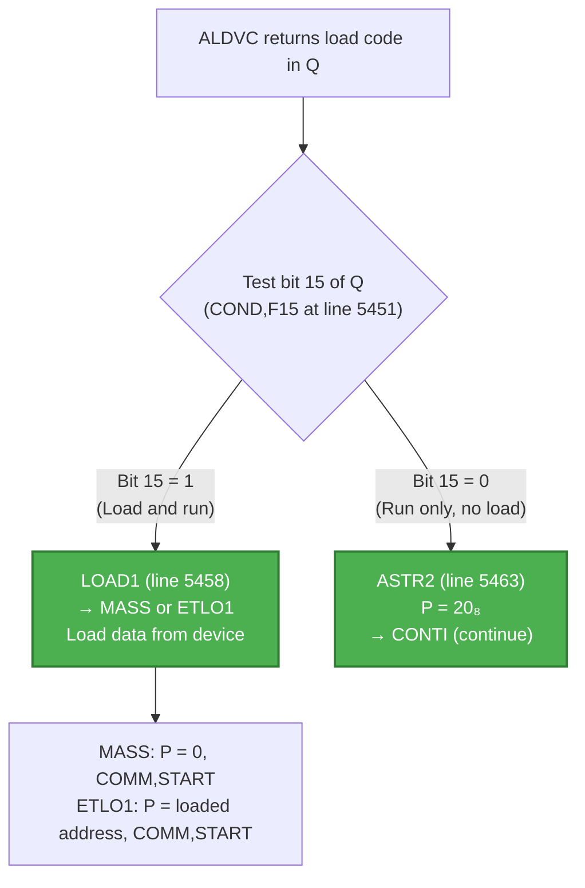

Source: `ND-110-RASK.uc` lines 5449-5465. Comment at line 5454: `LOAD IF BIT 15=1, START IN ADDRESS 20 IF BIT 15=0`

This maps to the ALD positions documented in OPCOM:

| ALD Positions | Bit 15 | Action |
|:---:|:---:|:---|
| 8-15 | 1 | Load from device, then start at **address 0** |
| 2-7 | 0 | No load — start at **address 20₈** (SINTRAN power-fail restart entry) |

Source: `OPCOM-COMMAND-REFERENCE.md` lines 653-658

Address 20₈ is the SINTRAN warm-start entry point. It's used when standby power preserved memory contents during a power failure — no loading is needed, the OS is already in memory. The microcode just jumps to 20₈ where SINTRAN's restart code resides.

Address 0 is the cold-start entry point. The bootstrap loaded into page 0 from disk starts executing here and loads the full SINTRAN image.

---

## Boot Data Size — All Device Types

| Boot Path | Device Types | Data Size | Source Address | Memory Address | Start Address |
|:---|:---|:---|:---|:---|:---|
| **MASS** | SMD, Winchester, SCSI (bit 13=1) | **1 page (1024 words / 2048 bytes)** | Block 0 | 0 | 0 |
| **ETLO1** | Floppy PIO, Floppy DMA, HDLC (bit 13=0) | **Variable — defined by BPUN stream** | Sector 0 (floppy) / remote (HDLC) | Defined in BPUN header | Defined in BPUN header |

**MASS path**: The microcode reads a fixed amount — 1 page from block 0. The bootstrap in that page is responsible for loading SINTRAN. This is the same for SMD, Winchester, and SCSI — the microcode is device-agnostic.

Source: `ND-110-RASK.uc` line 5359 comment, `ND-30.003.007 EN` line 2963

**ETLO1 path**: The microcode reads a variable amount. The BPUN binary format is self-describing — each block in the stream contains its own core address, word count, and checksum. The microcode reads bytes until the BPUN protocol indicates completion. For floppy boot, the controller's autoload microprogram reads track 0, sector 1 into its internal buffer first (source: `NDBusFloppyPIO.cs` line 570-585), then the microcode reads bytes from that buffer.

Source: `ND-110-RASK.uc` lines 5534-5640 (ETLO1 protocol), `NDBusFloppyPIO.cs` line 570 (floppy autoload reads track 0 sector 1)

After the initial bootstrap is loaded (by either path), the bootstrap program itself takes over and loads the full SINTRAN operating system using the disk swap driver.

Source: `ND-30.003.007 EN` line 2963-2965

---

## ETLO1 Binary Loader (005534) — Serial/Character Transfer

Used for **floppy, SCSI, HDLC** devices (load codes with bit 13 = 0). Reads a binary-format program character by character through IOX. The sequence is **identical for all serial devices** — only the device base address N differs.

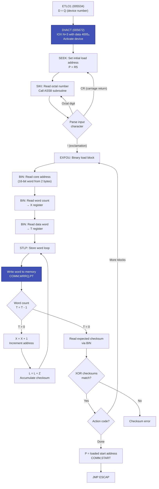

### ETLO1 Subroutines

#### INCH — Read One Character (005644)

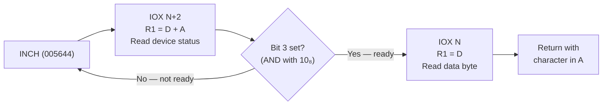

#### DVACT — Activate Device (005672)

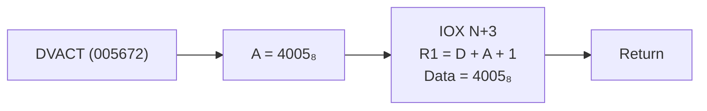

#### BIN — Read 16-bit Word (005731)

Reads two bytes via INCH and combines them into a 16-bit word.

### ETLO1 IOX Register Map

| IOX Offset | Used In | Purpose |
|:---:|:---|:---|
| N | INCH | Read data byte from device |
| N+2 | INCH | Read device status (poll for ready) |
| N+3 | DVACT | Activate device (data = 4005₈) |

### Status Polling (INCH)

- **Bit 3** (mask = 10₈): Data ready flag. Loop on IOX N+2 until set, then read byte from IOX N.

---

## IOXG Subroutine — IOX Routing (001363)

All IOX operations go through IOXG, which routes based on device number:

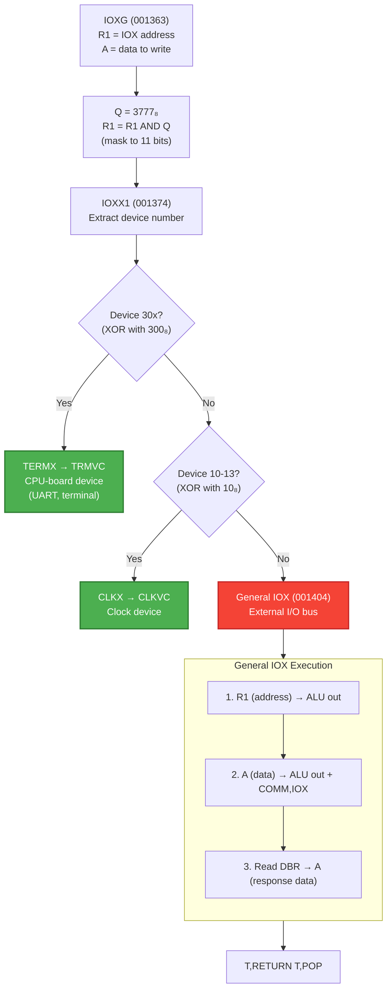

**For boot devices** (floppy N=1560, SMD N=20500, SCSI N=1600): These are NOT in the 30x or 10-13 range, so they always take the **General IOX** path which issues `COMM,IOX` on the external I/O bus.

---

## Complete Boot Sequence — Timing Diagram

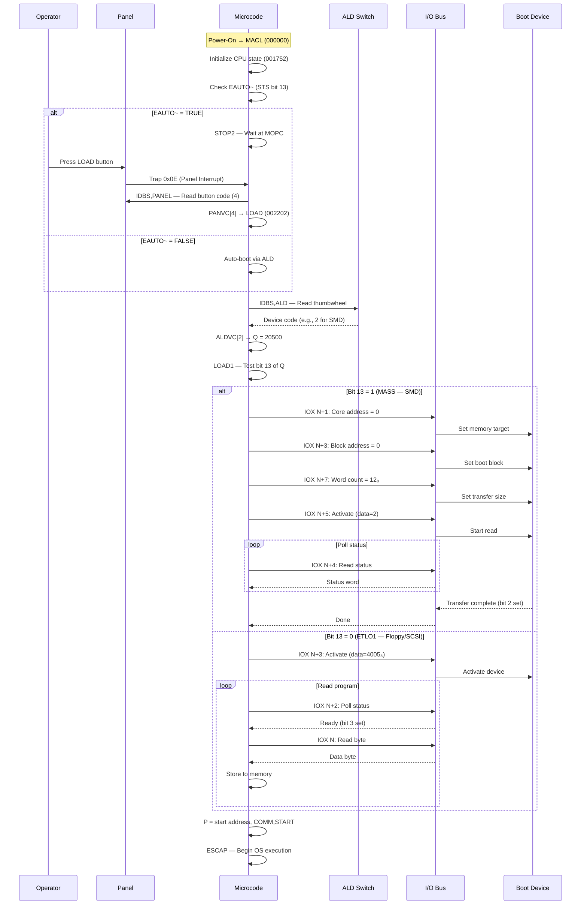

---

## Emulator Implementation Status

The microcode boot flow is executed by the emulator in `ND110CPU`. The microcode itself (loaded into ControlStore) contains all the logic — MACL, PANVC, ALDVC, MASS, ETLO1 are all microcode routines, not C# code.

### What works

| Component | Emulator File | How It Works |
|:---|:---|:---|
| MACL vector dispatch | `Cpu.cs` | Microcode at address 0 executes normally |
| Panel interrupt (trap 0x0E) | `CpuInternals.cs:246` | `Panel_OnPanelInterruptEvent()` → `SetTrap(0x0E)` |
| IDBS,PANEL | `Cpu.cs:2928` | Returns `panel.InterruptVector` |
| IDBS,ALD | `Cpu.cs:2901` | Returns ALD register with ND-110/ND-120 bit manipulation |
| COMM,LDLC | `Cpu.cs:1267` | Loads 6-bit signed loop counter from IDB |
| T,JMPAOPR | `Cpu.cs:792-799` | `(jmpAddress & 0x1FF0) \| (A_Operand & 0x0F)` — handles PANVC and ALDVC dispatch |
| MIC stack (PUSH/POP/RETURN) | `MIC.cs:290-336` | 4-level hardware stack for subroutine calls |
| Loop Counter as A/B operand | `Cpu.cs:2525,2483` | `loopCounter & 0x0F` feeds into ALU operands |
| EAUTO~ flag | `Uart.cs:59` | Controls MACL → STOP vs MACL → ALD path |

### Where boot breaks

| Component | Emulator File | Issue |
|:---|:---|:---|
| **IOX instruction** | `Cpu.cs:2028` | Stub — logs `"@@IOX"` and sets IOX Error interrupt |
| **IDENT instruction** | `Cpu.cs:2017` | Stub — no device identification |
| **I/O Bus** | Not implemented | No bus routing IOX addresses to controllers |
| **Device controllers** | Not implemented | No floppy, SMD, SCSI, or HDLC emulation |
| **ALD default value** | `Registers.cs:158` | Initialized to 0 — no boot device selected |

### Where execution stops

```
MACL ✓ → PANEL/LOAD ✓ → ALDLO ✓ → ALDVC ✓ → LOAD1 ✓ → MASS/ETLO1 ✓
  → First IOXG call → COMM,IOX ✗ (stub, sets IOX Error) → Boot fails
```

---

## Device IOX Register Maps — Cross-Reference with Microcode

The microcode MASS and ETLO1 loaders use generic IOX offsets (N+0 through N+7). The actual meaning of each offset depends on the device controller hardware. Here is how the microcode's IOX offsets map to each device type, based on the emulated drivers in `RetroCore\Emulated.HW\ND\CPU\NDBUS\`.

### Floppy PIO (NDBusFloppyPIO) — Device N = octal 1560

Used by **ETLO1** binary loader (ALD 1, load code 1560, bit 13 = 0).

| IOX Offset | Address | Register | Used in Boot? | Purpose |
|:---:|:---:|:---|:---:|:---|
| N+0 | 1560 | ReadDataBuffer | Yes (INCH) | Read one 16-bit word from interface buffer |
| N+1 | 1561 | WriteDataBuffer | — | Write data to buffer |
| N+2 | 1562 | ReadStatusRegister1 (RSR1) | Yes (INCH) | Poll for ready (bit 3 = ReadyForTransfer) |
| N+3 | 1563 | WriteControlWord (WCWD) | Yes (DVACT) | Issue commands. Microcode sends 4005₈ |
| N+4 | 1564 | ReadStatusRegister2 (RSR2) | — | Error status |
| N+5 | 1565 | WriteDriveAddress | — | Drive/track selection |
| N+6 | 1566 | ReadTestData | — | Test mode |
| N+7 | 1567 | WriteSector | — | Sector selection |

**PIO Control Word bits (IOX N+3 = WCWD):**

| Bit | Name | Boot Value (4005₈) |
|:---:|:---|:---:|
| 1 | Enable Interrupt | 0 |
| 2 | Autoload | **1** |
| 3 | Test Mode | 0 |
| 4 | Device Clear | 0 |
| 5 | Clear Buffer Address | 0 |
| 6 | Enable Timeout | 0 |
| 8 | Format Track | 0 |
| 9 | Write Data | 0 |
| 10 | Write Deleted Data | 0 |
| 11 | Read ID | **1** |
| 12 | Read Data | 0 |
| 13 | Seek | 0 |
| 14 | Recalibrate | 0 |
| 15 | Control Reset | 0 |

The microcode sends **4005₈** = 0b_100_000_000_101 = **Autoload (bit 2) + ReadID (bit 11)** via DVACT. This tells the PIO floppy controller to perform an autoload/boot sequence.

**PIO Status Register 1 bits (IOX N+2 = RSR1):**

| Bit | Name | Boot Check |
|:---:|:---|:---|
| 2 | Device Busy | — |
| 3 | Ready For Transfer | **Polled by INCH** (mask 10₈) |
| 6 | Read/Write Complete | — |

### Floppy DMA (NDBusFloppyDMA, card 3112) — Device N = octal 1560

Also at address 1560 but with **different register semantics**. The DMA controller has a critical difference: **Bit 2 of the Control Word is "Activate Autoload"** which triggers the controller's own boot microprogram to DMA boot code directly into ND-100 memory.

| IOX Offset | Address | Register | Used in Boot? | Purpose |
|:---:|:---:|:---|:---:|:---|
| N+0 | 1560 | ReadData | — | Read data |
| N+1 | 1561 | (Not Used) | — | — |
| N+2 | 1562 | ReadStatusRegister1 (RSR1) | Yes | Poll status |
| N+3 | 1563 | LoadControlWord | Yes (DVACT) | Commands + Autoload trigger |
| N+4 | 1564 | ReadStatusRegister2 (RSR2) | — | Format/error info |
| N+5 | 1565 | LoadPointerHigh | — | Memory address bits 16-23 |
| N+6 | 1566 | (Not Used) | — | — |
| N+7 | 1567 | LoadPointerLow / LoadData | — | Memory address bits 0-15 |

**DMA Control Word bits (IOX N+3):**

| Bit | Name | Boot Value (4005₈) |
|:---:|:---|:---:|
| 1 | Enable Interrupt | 0 |
| 2 | **Activate Autoload** | **1** |
| 3 | Test Mode | 0 |
| 4 | Device Clear | 0 |
| 5 | Enable Streamer | 0 |
| 8 | Execute Command | 0 |

**With 4005₈ = bit 2 + bit 11 set**: The DMA controller sees **ActivateAutoload = 1** and calls its internal `ExecuteAutoload()` microprogram, which DMA-transfers the boot code (BPUN bootstrapper) from the floppy's first sector directly into ND-100 memory — no further IOX interaction needed from the CPU microcode.

**DMA Status Register 1 bits (IOX N+2 = RSR1):**

| Bit | Name | Note |
|:---:|:---|:---|
| 2 | Device Active | Controller busy |
| 3 | Ready For Transfer | Polled by INCH |
| 5 | Deleted Record / EOF | — |
| 7 | Hard Error | — |
| 9-14 | Error Code | From controller microprogram |
| 15 | **Dual Density Controller** | **Always 1** = identifies as DMA (not PIO) |

Note: The DMA controller returns `RSR1 | DualDensityController` for **both** IOX N+2 and N+4 reads — they are intentionally duplicated so the microcode MASS loader (which reads N+4 for status) and the ETLO1 loader (which reads N+2) both work.

### SMD Disk Controller — Device N = octal 1540

Used by **MASS** block loader (ALD 2, load code 20500, bit 13 = 1).

| IOX Offset | Address | Register | Used in Boot? | Purpose |
|:---:|:---:|:---|:---:|:---|
| N+0 | 1540 | ReadMemoryAddress | — | Read back core address |
| N+1 | 1541 | **LoadMemoryAddress** | **Yes** | Set DMA target in ND-100 memory |
| N+2 | 1542 | ReadSeekCondition | — | Seek status |
| N+3 | 1543 | **LoadBlockAddress** | **Yes** | Set disk block to read |
| N+4 | 1544 | **ReadStatusRegister** | **Yes** | Poll for completion (bit 2) |
| N+5 | 1545 | **LoadControlWord** | **Yes** | Activate read operation |
| N+6 | 1546 | ReadBlockAddress | — | Read back block address |
| N+7 | 1547 | **LoadWordCounter** | **Yes** | Set transfer size |

This maps **exactly** to the MASS loader's IOX sequence:

| MASS Step | IOX | SMD Register | Data |
|:---|:---:|:---|:---:|
| Core address | N+1 | LoadMemoryAddress | 0 (load to address 0) |
| Block address | N+3 | LoadBlockAddress | 0 (boot block) |
| Word counter | N+7 | LoadWordCounter | 12₈ |
| Activate | N+5 | LoadControlWord | 2 (start read) |
| Poll status | N+4 | ReadStatusRegister | Check bit 2 |

### SCSI Controller (NDBusDiscControllerSCSI, card 3201) — Device N = octal 144300

The SCSI controller uses a **completely different addressing scheme** — 64 IOX registers (not 8). The SCSI controller is controlled by an onboard Z80 CPU with NCR5386 SCSI protocol chip.

| IOX Offset | Register | Purpose |
|:---:|:---|:---|
| N+0 | RLMAR | Read Memory Address bits 0-15 |
| N+1 | WLMAR | Write Memory Address bits 0-15 |
| N+2 | REDAT | Read Data (IOX mode only) |
| N+3 | WRDAT | Write Data (IOX mode only) |
| N+4 | RSTAU | Read Status |
| N+5 | WCONT | Write Control |
| N+6 | RHMAR | Read Memory Address bits 16-23 |
| N+7 | WHMAR | Write Memory Address bits 16-23 |

The first 8 registers follow the same general pattern as SMD — the microcode's generic IOX N+1/N+3/N+5/N+7/N+4 sequence maps to equivalent functions.

### Why the Same Microcode Works for All Devices

The ND-100 bus device standard requires all mass storage controllers to implement a **common IOX register layout** for the first 8 offsets:

```
N+0: Read data / Read memory address
N+1: Write data / Load memory address
N+2: Read status 1
N+3: Write control / Load block address
N+4: Read status 2 / Read status
N+5: Write address / Load control word
N+6: Read test / Read block address
N+7: Write sector / Load word counter
```

This is why the MASS loader's generic sequence works identically for SMD, SCSI, and DMA floppy controllers — they all follow the same register convention. The PIO floppy uses a slightly different convention (data at N+0/N+1 instead of memory address), which is why it uses the ETLO1 serial path instead.

### HDLC Auto Load — Device N = octal 1600

Used by **ETLO1** binary loader (ALD 5, load code 1600, bit 13 = 0).

HDLC boot uses a **dedicated autoload interface** at IOX 1600-1603 on the PCB 3015 (HDLC + Autoload) card. This is separate from the main HDLC DMA/PIO interface (IOX 1640+). The autoload interface has only 4 registers — a simplified bootstrap-only interface.

#### HDLC Auto Load Register Map (IOX 1600-1603)

| IOX | Address | R/W | Register | Used in Boot? |
|:---:|:---:|:---:|:---|:---:|
| N+0 | 1600 | Read | **Read Data** | **Yes** (INCH) |
| N+1 | 1601 | Write | (Write Data / Control) | — |
| N+2 | 1602 | Read | **Read Status** | **Yes** (INCH) |
| N+3 | 1603 | Write | **Write Control Word** | **Yes** (DVACT) |

#### IOX 1600 — Read Data (N+0)

Read one byte of the incoming boot program from the HDLC controller's receive buffer.

| Bits | Description |
|:---:|:---|
| 0-7 | Received data byte |
| 8-15 | Unused |

#### IOX 1602 — Read Status (N+2)

Status register polled by the INCH subroutine during boot.

| Bit | Name | Description |
|:---:|:---|:---|
| 0 | — | Not used |
| 1 | Interrupt Enabled | Interrupt flag |
| 2 | Device Busy | Controller is processing |
| **3** | **Ready For Transfer** | **Data byte available — polled by INCH (mask 10₈)** |
| 4 | Error indicator | OR of error bits |
| 5-15 | — | Additional status / unused |

The INCH subroutine tests bit 3 (AND with 10₈ = 8 decimal). When set, it means a byte is available to read from IOX 1600.

#### IOX 1603 — Write Control Word (N+3)

Written by DVACT to activate the autoload process. The microcode sends **4005₈**.

**4005₈ = 0b_100_000_000_101 = 0x0805**

| Bit | Value | Name | Description |
|:---:|:---:|:---|:---|
| 0 | 1 | — | Set |
| 1 | 0 | Enable Interrupt | Not enabled during boot |
| **2** | **1** | **Activate Autoload** | **Triggers the HDLC controller to request boot image from remote machine** |
| 3 | 0 | Test Mode | Not set |
| 4 | 0 | Device Clear | Not set |
| 5-7 | 0 | — | Not used |
| 8 | 0 | — | Not set |
| 9 | 0 | — | Not set |
| 10 | 0 | — | Not set |
| **11** | **1** | (Command bit) | Set (same pattern as floppy PIO ReadID) |
| 12-15 | 0 | — | Not set |

The critical bit is **bit 2 (Activate Autoload)**. When the HDLC controller sees this, it initiates a boot request over the HDLC link to the remote ND machine. The remote machine (running SINTRAN with HDLC remote load support) responds by transmitting the binary boot program.

This is the same control word pattern (4005₈) used by the floppy PIO (where bit 2 = Autoload) and floppy DMA (where bit 2 = ActivateAutoload). All three devices interpret 4005₈ as "start the boot/autoload process."

#### HDLC Remote Load Channels (IOX 1604-1637)

In addition to the auto load interface, the PCB 3015 card provides 7 **HDLC Remote Load** channels for loading from specific HDLC link numbers:

| Channel | IOX Range | Purpose |
|:---:|:---:|:---|
| 1 | 1604-1607 | Remote load from HDLC link 1 |
| 2 | 1610-1613 | Remote load from HDLC link 2 |
| 3 | 1614-1617 | Remote load from HDLC link 3 |
| 4 | 1620-1623 | Remote load from HDLC link 4 |
| 5 | 1624-1627 | Remote load from HDLC link 5 |
| 6 | 1630-1633 | Remote load from HDLC link 6 |
| 7 | 1634-1637 | Remote load from HDLC link 7 |

Each channel has the same 4-register layout as the auto load (N+0 through N+3). These are not referenced in the ALDVC table but can be used for directed network boot from a specific link.

#### HDLC Auto Load — Detailed Flow

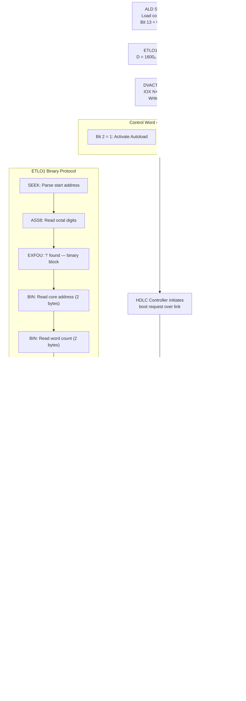

```mermaid
sequenceDiagram
    participant UC as CPU Microcode<br/>(ETLO1)
    participant AL as HDLC Auto Load<br/>(IOX 1600-1603)
    participant CTRL as HDLC Controller<br/>(PCB 3015)
    participant LINK as HDLC Link
    participant REMOTE as Remote ND Machine<br/>(SINTRAN)

    Note over UC: ALD=5 → ALDVC → Q=1600₈ → ETLO1

    UC->>AL: IOX 1603: Write 4005₈<br/>(Bit 2: Activate Autoload)
    AL->>CTRL: Autoload triggered
    CTRL->>LINK: HDLC boot request frame
    LINK->>REMOTE: Request boot image

    REMOTE-->>LINK: Binary boot stream<br/>(octal header + ! + binary blocks)
    LINK-->>CTRL: Receive HDLC frames
    CTRL-->>AL: Buffer received bytes

    loop INCH — read each byte
        UC->>AL: IOX 1602: Read status
        AL-->>UC: Status (check bit 3)
        Note over UC: Loop until bit 3 = 1
        UC->>AL: IOX 1600: Read data byte
        AL-->>UC: One byte
    end

    Note over UC: ASS8: Parse octal start address
    Note over UC: EXFOU: '!' delimiter found

    loop BIN — read 16-bit words
        UC->>AL: IOX 1602 → IOX 1600 (high byte)
        UC->>AL: IOX 1602 → IOX 1600 (low byte)
        UC->>UC: Store word to memory[X]<br/>X++, T-- (word count)
        UC->>UC: L = L + Z (accumulate checksum)
    end

    UC->>AL: IOX 1602 → IOX 1600 (checksum high)
    UC->>AL: IOX 1602 → IOX 1600 (checksum low)
    UC->>UC: Verify: XOR(L, expected) = 0?

    alt Checksum OK
        UC->>UC: P = loaded start address
        UC->>UC: COMM,START → ESCAP
        Note over UC: Begin OS execution
    else Checksum Error
        UC->>UC: Error handling
    end
```

#### Comparison: All ETLO1 Devices

All three device types that use the ETLO1 binary serial loader share the same 4-register autoload pattern:

| | Floppy PIO | Floppy DMA (3112) | HDLC Auto Load (3015) |
|:---|:---|:---|:---|
| **IOX Base** | 1560₈ | 1560₈ | 1600₈ |
| **N+0 Read** | Read data buffer | Read data | Read data byte |
| **N+2 Read** | RSR1 (bit 3 = ready) | RSR1 (bit 3 = ready) | Status (bit 3 = ready) |
| **N+3 Write** | Control word | Control word | Control word |
| **Boot command** | 4005₈ | 4005₈ | 4005₈ |
| **Bit 2 meaning** | Autoload | Activate Autoload | Activate Autoload |
| **Data source** | Floppy disk sector | DMA from floppy | HDLC link from remote |
| **Transfer** | Byte-by-byte PIO | Controller DMA, then PIO | Byte-by-byte PIO |

#### Main HDLC DMA/PIO Controller — Full Register Map (IOX 1640+)

For reference, the main HDLC controller (used by SINTRAN for normal data communication, NOT for boot) has 16 registers. This is the interface at IOX 1640-1657 (for HDLC unit 1):

| IOX | R/W | Register | Description |
|:---:|:---:|:---|:---|
| +0 | R | ReadRxDR | Receiver Data Register — read assembled character from COM5025 |
| +1 | W | WritePCR | Parameter Control Register — protocol config (CRC, idle mode, etc.) |
| +2 | R | ReadReceiverStatusRegister | Receiver status from COM5025 |
| +3 | W | WriteSAR | Sync/Address Register — HDLC station address or SYNC character |
| +4 | R/W | CharacterLength | Character length config (receiver bits 0-2, transmitter bits 5-7) |
| +5 | W | WriteTransmitterDataRegister | Transmit Data Register — write byte to send |
| +6 | R | ReadTransmitterStatusRegister | Transmitter status from COM5025 |
| +7 | W | WriteTransmitterControlRegister | Transmitter control (same register as +6) |
| +10 | R | ReadReceiverTransferStatus (RRTS) | Receiver transfer status — see bit table below |
| +11 | W | WriteReceiverTransferControl (WRTC) | Receiver enable, DMA, interrupts, DTR |
| +12 | R | ReadTransmitterTransferStatus (RTTS) | Transmitter transfer status |
| +13 | W | WriteTransmitterTransferControl | Transmitter enable, DMA, RQTS |
| +14 | R | ReadDMAAddress | Read back DMA address |
| +15 | W | WriteDMAAddress | Set DMA buffer list base address (bits 0-15) |
| +16 | R | ReadDMACommand | Read DMA command register (0 = ready for new command) |
| +17 | W | WriteDMACommand | Write DMA command + address bits 16-17 |

##### RRTS — Receiver Transfer Status (IOX +10) Bit Map

| Bit | Name | Description |
|:---:|:---|:---|
| 0 | DataAvailable | Character assembled, ready to read from RxDR. IRQ 13 if enabled |
| 1 | StatusAvailable | Status info available in receiver status register. IRQ 13 if enabled |
| 2 | ReceiverActive | Receiver is within a frame (seen start, not end) |
| 3 | SyncFlagReceived | At least one SYNC/FLAG received since last read |
| 4 | DMAModuleRequest | DMA module requesting attention (cleared on read) |
| 5 | SignalDetector (SD) | CCITT 109 — modem signal (ignored by SINTRAN) |
| 6 | DataSetReady (DSR) | CCITT 107 — modem signal (ignored by SINTRAN) |
| 7 | RingIndicator (RI) | CCITT 125 — ring indicator |
| 8 | BlockEnd | DMA block transfer complete (cleared on read) |
| 9 | FrameEnd | DMA frame transfer complete (cleared on read) |
| 10 | ListEnd | End of DMA descriptor list |
| 11 | ListEmpty | No receive buffers — FATAL, shuts down receiver |
| 12 | (Undefined) | — |
| 13 | X21D | X.21 data indication error |
| 14 | X21S | X.21 call setup/clear indication error |
| 15 | ReceiverOverrun | Buffer overrun |

##### WRTC — Receiver Transfer Control (IOX +11) Bit Map

| Bit | Name | Description |
|:---:|:---|:---|
| 0 | DataAvailableIE | Enable IRQ 13 on data available |
| 1 | StatusAvailableIE | Enable IRQ 13 on status available |
| 2 | EnableReceiver (RXE) | Enable serial data into receiver |
| 3 | EnableReceiverDMA | Data available triggers DMA request |
| 4 | DMAModuleIE | Enable IRQ 13 on DMA module request |
| 5 | DeviceClear / SelectMaintenance | Clear + enter maintenance (loopback) mode |
| 6 | DTR | Data Terminal Ready (CCITT 108) to modem |
| 7 | ModemStatusChangeIE | Enable IRQ 13 on modem signal change (SD/DSR/RI) |
| 8 | BlockEndIE | DMA: enable IRQ on block end |
| 9 | FrameEndIE | DMA: enable IRQ on frame end |
| 10 | ListEndIE | DMA: enable IRQ on list end |
| 15 | Bit15 | Always 1 after DUMP command |

##### RTTS — Transmitter Transfer Status (IOX +12) Bit Map

| Bit | Name | Description |
|:---:|:---|:---|
| 0 | TransmitBufferEmpty | Transmit buffer ready for next byte |
| 1 | TransmitUnderrun | Transmitter underrun occurred |
| 2 | TransmitterActive | Transmitter is active (sending) |
| 3 | ReadyForSending (CTS) | CCITT 106 — Clear To Send from modem |
| 4 | DMAModuleRequest | DMA module requesting attention (cleared on read) |
| 8 | BlockEnd | DMA: block transfer complete |
| 9 | FrameEnd | DMA: frame transfer complete |
| 10 | ListEnd | DMA: end of descriptor list |
| 11 | ListEmpty | DMA: no transmit buffers |

##### TTC — Transmitter Transfer Control (IOX +13) Bit Map

| Bit | Name | Description |
|:---:|:---|:---|
| 0 | TransmitBufferEmptyIE | Enable IRQ 12 on buffer empty |
| 1 | TransmitUnderrunIE | Enable IRQ 12 on underrun |
| 2 | TransmitterEnabled (TXE) | Enable transmitter |
| 3 | EnableTransmitterDMA | Buffer empty triggers DMA request |
| 4 | DMAModuleIE | Enable IRQ 12 on DMA module request |
| 5 | HalfDuplex | Half-duplex mode |
| 6 | RQTS | Request To Send (CCITT 105) to modem |
| 7 | CTS_StatusChangeIE | Enable IRQ 12 on CTS change |
| 8 | BlockEndIE | DMA: enable IRQ on block end |
| 9 | FrameEndIE | DMA: enable IRQ on frame end |
| 10 | ListEndIE | DMA: enable IRQ on list end |

##### DMA Command Register (IOX +17, Write) Bit Map

| Bits | Name | Description |
|:---:|:---|:---|
| 0-3 | Bank Bits | Memory address bits 16-19 |
| 4-7 | (Unused) | — |
| 8-10 | Command | DMA command (see below) |
| 11-15 | (Unused) | — |

DMA Commands (bits 8-10):

| Code | Command | Description |
|:---:|:---|:---|
| 0 | DEVICE_CLEAR | Clear DMA module |
| 1 | INITIALIZE | Initialize DMA from buffer descriptors |
| 2 | RECEIVER_START | Start DMA receive |
| 3 | RECEIVER_CONTINUE | Continue receive after block end |
| 4 | TRANSMITTER_START | Start DMA transmit |
| 5 | DUMP_DATA_MODULE | Dump data module registers to memory |
| 6 | DUMP_REGISTERS | Dump DMA registers to memory |
| 7 | LOAD_REGISTERS | Load DMA registers from memory |

---

## HDLC Remote Load — Complete Network Boot Architecture

HDLC remote load is a network boot mechanism that allows one ND machine to boot another over an HDLC (High-Level Data Link Control) serial link. This was part of the ND-Net networking system, introduced in SINTRAN III K-version.

### Architecture Overview

The HDLC remote load involves **two machines** with distinct roles:

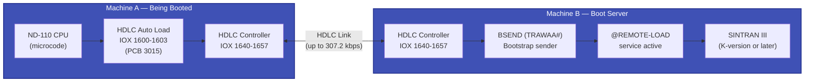

### Roles

#### Machine A — Client (Being Booted)

- Has no operating system running (it's being booted)
- The CPU microcode drives the entire process
- Uses the dedicated **HDLC Auto Load** interface (IOX 1600-1603) — a simplified 4-register bootstrap-only interface on the PCB 3015 card
- Sends a boot request, then receives the binary boot program byte-by-byte via the ETLO1 microcode loader

#### Machine B — Server (Boot Provider)

- Already running SINTRAN III with ND-Net support
- The `@REMOTE-LOAD` command has been issued to enable remote load service
- SINTRAN's HDLC driver contains dedicated routines for serving boot requests:
  - **BSINIT** (routine CBSIN#) — Initializes a remote load session when a request arrives
  - **BSEND** (routine TRAWAA#) — Transmits the bootstrap binary (BPUN format) over HDLC
- The boot image is sent as a standard BPUN binary stream — the same format used for floppy and paper tape boot

### SINTRAN Server-Side Data Structures

From ND-60112 SINTRAN III System Documentation, Appendix A — the HDLC line data field contains these remote-load-specific entries:

| Offset | Field | Initial Value | Purpose |
|:---:|:---|:---|:---|
| 13 | SINIT | CSINI# | Normal line initialization routine |
| **14** | **BSINIT** | **CBSIN#** | **Remote load initialization** — called when a boot request is received |
| 23 | SEND | TSEND# | Normal data send routine |
| **24** | **BSEND** | **TRAWAA#** | **Bootstrap send routine** — transmits BPUN binary to requesting machine |
| 25 | RECEIVE | TRECE# | Normal data receive routine |
| 27 | RMLNR | n | Remote line number for this connection |

When Machine A's HDLC autoload triggers, the HDLC controller on Machine A sends a request frame over the link. Machine B's HDLC interrupt handler recognizes this as a boot request and dispatches to BSINIT (CBSIN#), which sets up the transfer session. Then BSEND (TRAWAA#) reads the boot image and transmits it frame by frame over the HDLC link.

### OPCOM Boot Commands for HDLC

From the operator console (OPCOM), HDLC network boot can be initiated:

| Command | Load Code | Action |
|:---|:---:|:---|
| `#1600&` | 001600₈ | BPUN load from HDLC, auto-start at 20₈ |
| `#1600$` | 001600₈ | BPUN load from HDLC, CPU stops after load |

Via ALD thumbwheel:

| ALD Position | I12 Value | Action |
|:---:|:---:|:---|
| 10 | 001600₈ | BPUN load from HDLC (1600₈) and run from 20₈ |
| 2 | 101600₈ | Binary load from HDLC (1600₈), load only |

### I12 Register (ALD) Bit Decoding for HDLC

The I12 register value encodes three fields:

| Bits | Value for HDLC | Meaning |
|:---:|:---:|:---|
| 17 (MSB) | 0 or 1 | 0 = load on power loss only (positions 8-15), 1 = always load (positions 2-7) |
| 16 | 0 | 0 = BPUN (binary) format. HDLC always uses BPUN, never mass storage bootstrap |
| 15-0 | 001600₈ | Device address = HDLC Auto Load |

### HDLC Hardware — Auto Load vs Remote Load vs Data Interfaces

The PCB 3015 (HDLC + Autoload) card exposes three distinct IOX address ranges:

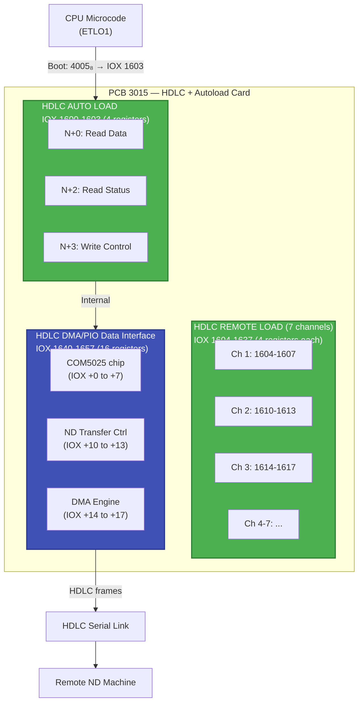

| Interface | IOX Range | Registers | Purpose |
|:---|:---:|:---:|:---|
| **HDLC AUTO LOAD** | 1600-1603 | 4 | Bootstrap interface — used by microcode ETLO1 for boot |
| **HDLC REMOTE LOAD** | 1604-1637 | 4 per channel (7 channels) | Directed boot from specific HDLC link number |
| **HDLC DMA/PIO** | 1640-1657 | 16 | Normal HDLC data communication (used by SINTRAN) |

The AUTO LOAD and REMOTE LOAD interfaces are **simplified bootstrap-only** interfaces. They share the same 4-register pattern (N+0 = data, N+2 = status, N+3 = control) but are separate IOX address ranges. The actual HDLC framing and link management is handled by the main DMA/PIO interface internally.

### Complete HDLC Boot Sequence — Both Sides

```mermaid
sequenceDiagram
    participant OP_A as Operator<br/>(Machine A)
    participant UC as CPU Microcode<br/>(Machine A)
    participant AL as HDLC Auto Load<br/>(IOX 1600-1603)
    participant LINK as HDLC Link<br/>(serial)
    participant HDLC_B as HDLC Controller<br/>(Machine B)
    participant SIN as SINTRAN<br/>(Machine B)

    Note over SIN: Prerequisite: @REMOTE-LOAD<br/>has been issued on Machine B

    OP_A->>UC: Press LOAD button<br/>(or type #1600& at OPCOM)
    UC->>UC: PANEL → PANVC[4] → LOAD
    UC->>UC: ALDLO: Read ALD switch<br/>or use typed device address
    UC->>UC: ALDVC → Q = 1600₈
    UC->>UC: LOAD1: Bit 13 = 0 → ETLO1

    rect rgb(42, 106, 58)
        Note over UC,AL: DVACT — Activate Device
        UC->>AL: IOX 1603: Write 4005₈<br/>(Bit 2 = Activate Autoload)
        AL->>LINK: Boot request frame
        LINK->>HDLC_B: Received boot request
        HDLC_B->>SIN: Interrupt → BSINIT (CBSIN#)
        SIN->>SIN: Initialize remote load session
    end

    rect rgb(42, 58, 106)
        Note over SIN,UC: BSEND (TRAWAA#) — Send Bootstrap
        SIN->>SIN: Read BPUN boot image
        SIN->>HDLC_B: Start transmitting BPUN data
        HDLC_B->>LINK: HDLC data frames

        loop ETLO1 Binary Loader
            LINK-->>AL: Data available

            rect rgb(60, 60, 80)
                Note over UC,AL: INCH — Read One Byte
                UC->>AL: IOX 1602: Read status
                AL-->>UC: Check bit 3
                Note over UC: Loop until bit 3 = 1
                UC->>AL: IOX 1600: Read data byte
                AL-->>UC: One byte of BPUN stream
            end

            Note over UC: ASS8: Parse octal numbers<br/>until '!' delimiter found

            rect rgb(60, 80, 60)
                Note over UC: EXFOU — Process Binary Block
                UC->>UC: BIN: Read core address (2 bytes via INCH)
                UC->>UC: BIN: Read word count (2 bytes via INCH)
                loop STLP — Store Words
                    UC->>UC: BIN: Read 16-bit word (2 bytes via INCH)
                    UC->>UC: Store to memory[X], X++, T--
                    UC->>UC: Accumulate checksum: L = L + Z
                end
                UC->>UC: BIN: Read expected checksum
                UC->>UC: Verify: XOR(L, expected) = 0?
            end
        end
    end

    rect rgb(106, 58, 42)
        Note over UC: Boot Complete
        UC->>UC: P = start address (20₈)
        UC->>UC: COMM,START (clear STOP)
        UC->>UC: JMP ESCAP
        Note over UC: OS execution begins at 20₈
    end
```

### BPUN Binary Format (What Gets Transmitted)

The BPUN (Binary PUNched) format transmitted over HDLC is a simple binary image format:

```
<octal-header><CR>         ← Optional: start address in octal ASCII
!                          ← Delimiter: start of binary block
<address-high><address-low> ← 16-bit core load address (2 bytes)
<count-high><count-low>     ← 16-bit word count (2 bytes)
<word-high><word-low>       ← Data word 1
<word-high><word-low>       ← Data word 2
...                         ← (word-count words total)
<checksum-high><checksum-low> ← 16-bit checksum (XOR of all data words)
```

Multiple blocks can be concatenated. The microcode ETLO1 loader processes each block, verifies the checksum, then continues to the next block until the entire program is loaded.

### Why HDLC Uses BPUN (Not Mass Storage Bootstrap)

Mass storage bootstrap (bit 13 = 1) is designed for devices with **block-addressable storage** — the microcode issues IOX commands to set core address, block address, word count, and activate a DMA transfer. This requires a device that understands sector/block addressing.

HDLC is a **serial stream** — there are no blocks or sectors. The data arrives byte-by-byte over the link. The BPUN format is a self-describing serial format that includes addresses and checksums in the data stream itself, making it ideal for serial transfer. This is the same format used for:
- Paper tape reader (IOX 400₈)
- Floppy PIO (IOX 1560₈)
- HDLC auto load (IOX 1600₈)

All three use the ETLO1 binary loader path in the microcode.

### HDLC Protocol for Remote Load

> **NOTE: Significant gaps in documentation.** The exact protocol used between the autoload interface (IOX 1600-1603) and the remote SINTRAN machine is **not documented** in any available source. The sections below separate verified facts from unknowns.

#### What IS verified (from source code and hardware docs)

**HDLC frame format** — from `01-HDLC-Hardware-Reference.md` and COM5025 datasheet:

```
┌──────┬─────────┬─────────┬───────────────────┬─────────┬──────┐
│ Flag │ Address │ Control │       Data        │   FCS   │ Flag │
│ 7E₁₆ │  1 byte │  1 byte │    0-N bytes      │ 2 bytes │ 7E₁₆ │
└──────┴─────────┴─────────┴───────────────────┴─────────┘──────┘
```

- **Flag**: 0x7E — generated/detected by COM5025 hardware
- **FCS**: CRC-16-CCITT — computed by COM5025 hardware
- **Control field types**: I-frames (data), S-frames (flow control), U-frames (link management) — standard HDLC/LAPB

Source: `NDInsight\SINTRAN\Devices\HDLC\01-HDLC-Hardware-Reference.md`, `NDInsight\SINTRAN\TAD\TAD-HDLC-Encapsulation.md`

**DMA-based HDLC controller** uses LAPB for normal data communication — from `05-HDLC-Protocol-Implementation.md` and the NPL driver source.

**BPUN format is used** — from OPCOM reference: `#1600&` is listed as "BPUN (binary)" load format.

Source: `NDInsight\Operations\SINTRAN\OPCOM-COMMAND-REFERENCE.md` line 150

#### What is NOT known

- **Whether the autoload interface (IOX 1600-1603) uses LAPB at all.** The autoload is a dedicated 4-register interface separate from the full HDLC DMA controller (IOX 1640+). It may use a simpler proprietary protocol, or it may just present raw bytes from the COM5025 receiver.
- **How the boot request is signaled at the frame level.** We know the CPU writes 4005₈ to IOX 1603, but what the HDLC controller sends on the wire is unknown.
- **Whether X.25 is involved.** X.25 is used for COSMOS/TAD data, but remote load may bypass X.25 entirely.
- **The exact handshake between the two machines.** SABM/UA is standard LAPB, but the autoload path might not use it.
- **How the server (TRAWAA#) frames the BPUN data.** The TRAWAA# routine is not in the available NPL source files.

The missing documentation is likely in **ND-12.018 HDLC Interface manual** (referenced in NDBusHDLC.cs comments) which is not available in the NDInsight collection.

### DMA Descriptor Format (LKEY)

The HDLC DMA hardware uses descriptor lists in ND-100 memory. Each descriptor has this format:

```
┌──────────────────┐  Offset 0
│    LKEY (16 bits) │  Control key — COM5025 commands + status flags
├──────────────────┤  Offset 1
│   LBYTC (16 bits) │  Byte count for this buffer
├──────────────────┤  Offset 2
│   LMEM1 (16 bits) │  Physical bank / high address bits
├──────────────────┤  Offset 3
│   LMEM2 (16 bits) │  Buffer memory address (low 16 bits)
└──────────────────┘
```

#### LKEY Bit Fields

| Bit | Name | Purpose |
|:---:|:---|:---|
| 0 | TSOM / RSOM | Transmit/Receive Start Of Message — opening FLAG |
| 1 | TEOM / REOM | Transmit/Receive End Of Message — closing FLAG + CRC |
| 2 | TABORT | Transmit Abort (7+ consecutive 1s) |
| 3 | TGA / XBLDN | Transmit Go Ahead / External Block Done |
| 8-15 | (DMA status) | Block end, frame end, list end flags |

**Key LKEY Constants:**

| Constant | Value | Meaning |
|:---|:---:|:---|
| FSERM | 0x1003 (octal 10003) | Single complete frame: TSOM + TEOM + flag bits |
| ERB | 0x0400 (octal 2000) | Empty Receiver Block — ready for incoming data |
| NLP | (end marker) | New List Pointer — marks end of descriptor chain |

---

## SINTRAN XSSND / XSHDR Interfaces — Programming Guide

The HDLC driver in SINTRAN exposes two privileged interfaces for direct DMA frame transfer. These are the interfaces that the ND-Net remote load service (TRAWAA#/CBSIN#) uses to send and receive boot data.

All information in this section is verified from source code and documentation:
- NPL source: `SINTRAN\NPL-SOURCE\NPL\MP-P2-HDLC-DRIV.NPL` in the NDInsight repository
- Deep dive analysis: `SINTRAN\Devices\HDLC\deep-dives\Deep-Dive-XSSDATA.md` in the NDInsight repository
- Driver setup docs: `SINTRAN\Devices\DEVICE_DRIVER_SETUP_DOCUMENTATION.md` in the NDInsight repository
- Interrupt analysis: `SINTRAN\Devices\HDLC\deep-dives\Deep-Dive-Interrupt-Control.md` in the NDInsight repository

### XMSG and MON Call Architecture

XSSND and XSHDR are **NOT** monitor calls. They are internal HDLC driver functions accessed through the XMSG messaging system. The call chain is:

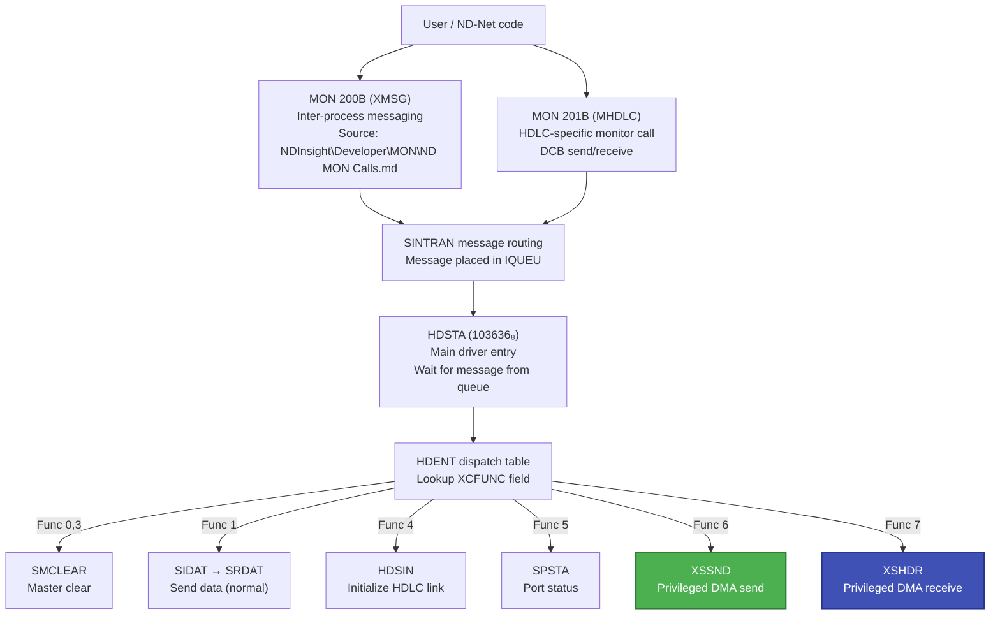

Source: NPL source line 39: `INTEGER ARRAY HDENT:=(SMCLEAR,SIDAT,SIRES,SMCLEAR,HDSIN,SPSTA,XSSND,XSHDR)`

**MON 200B (XMSG)** — the inter-process messaging system. All data communication in SINTRAN goes through XMSG. The COSMOS Programmer Guide (`Operations\Cosmos\ND-60164-3-EN COSMOS Programmer Guide.md` in the NDInsight repository) documents the full XMSG API:
- XFOPN — Open a port
- XFSND — Send message
- XFRCV — Receive message
- XFGET — Reserve message buffer
- XFREL — Release message buffer
- XFCRD — Create driver (system function)
- XFSTD — Start driver (system function)

Source: `Developer\MON\ND MON Calls.md` in the NDInsight repository lines 12838-12850

**MON 201B (MHDLC)** — the HDLC-specific monitor call. Parameters:
- Param1: Function code (0 = send DCB to driver, 1 = receive DCB from driver)
- Param2: Logical device number (e.g., 1360 for HDLC-1)
- Param3: Address of Driver Control Block (DCB)
- Param4: Used DCB size in bytes
- Param5: Maximum DCB size in bytes

Source: `Developer\MON\ND MON Calls.md` in the NDInsight repository lines 12854-12916

### HDLC Message Structure

Every message to the HDLC driver has this structure (from `DEVICE_DRIVER_SETUP_DOCUMENTATION.md` line 221):

| Field | Offset | Description |
|:---|:---:|:---|
| XCFUNC | BHEAD+0 | Function code (0-7, indexes into HDENT table) |
| CRET | BHEAD+1 | Return status (filled by driver on completion) |
| ADSTA | BHEAD+2 | Hardware status (RRTS or RTTS value) |
| BBYTC | BHEAD+3 | Actual byte count |
| BMBYT | BHEAD+4 | Maximum byte count |
| Data | BHEAD+6+ | Transmitted/received data payload |

For privileged XSSND/XSHDR calls, the message must have BBID < 0 (negative = XMSG privileged message).

Source: `SINTRAN\Devices\DEVICE_DRIVER_SETUP_DOCUMENTATION.md` in the NDInsight repository lines 221-230

### Message Flow — Transmit and Receive

Source: `SINTRAN\Devices\DEVICE_DRIVER_SETUP_DOCUMENTATION.md` in the NDInsight repository lines 709-738

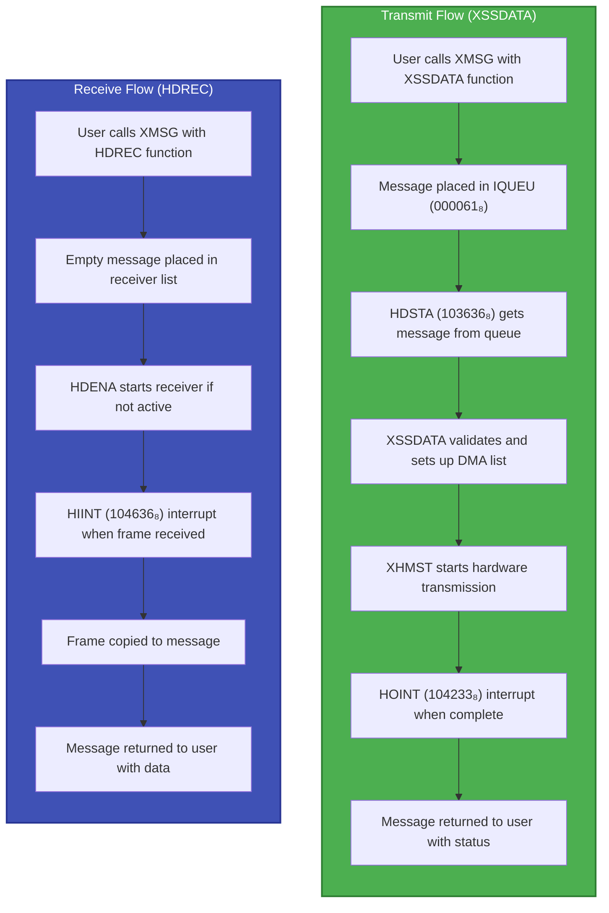

### Driver Dispatch Table

Source: NPL source `MP-P2-HDLC-DRIV.NPL` line 39

```npl
INTEGER ARRAY HDENT:=(SMCLEAR, SIDAT, SIRES, SMCLEAR, HDSIN, SPSTA, XSSND, XSHDR)
%                      0        1      2      3        4      5      6      7
```

| Index | Function | Handler | Purpose | Source Line |
|:---:|:---|:---|:---|:---:|
| 0 | SMCLEAR | SMCLEAR | Master clear | 439 |
| 1 | SIDAT | SRDAT | Send data (normal) | 75 |
| 2 | SIRES | SRREST | Response | 76 |
| 3 | SMCLEAR | SMCLEAR | Master clear (duplicate) | 439 |
| 4 | HDSIN | HDSIN | Initialize HDLC link | 487 |
| 5 | SPSTA | SPSTA | Port status query | 602 |
| **6** | **XSSND** | **XSSND** | **Privileged DMA send** | **253** |
| **7** | **XSHDR** | **XSHDR** | **Privileged DMA receive** | **283** |

### XSSND — Privileged DMA Transmit

Source: `SINTRAN\Devices\HDLC\deep-dives\Deep-Dive-XSSDATA.md` in the NDInsight repository (line-by-line analysis)
Source: NPL source `MP-P2-HDLC-DRIV.NPL` lines 253-264

**Purpose**: Send an HDLC frame using a pre-built DMA transmitter list. Used by privileged callers (XMSG system, ND-Net) that manage their own DMA descriptor lists. Also serves as the **retransmission entry point** — called via DRERR when transmission errors occur (DRERR → SRDAT → XSSND).

Source for dual purpose: Deep-Dive-XSSDATA.md lines 280-316

**Entry conditions**:
- Message ID < 0 (privileged XMSG message — verified by ZXCHK at NPL line 137)
- INTSTA = 2 (interface initialized via HDSIN)
- First two data words of the DCB (Data Control Block) contain a pointer to the DMA transmitter list (XMLIS)

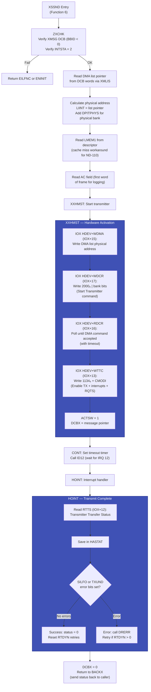

#### XSSND IOX Sequence (Exact)

| Step | IOX Register | Value | Purpose |
|:---:|:---|:---|:---|
| 1 | WDMA (IOX+15) | Physical address of DMA list | Set DMA descriptor base |
| 2 | WDCR (IOX+17) | 0x2000 \| bank_bits | Start Transmitter DMA command |
| 3 | RDCR (IOX+16) | (poll read) | Wait for command accepted (loops with timeout) |
| 4 | WTTC (IOX+13) | 0x1134 + CMODI | Enable: TxBufferEmptyIE + TxEnabled + RQTS + DMA IE |
| — | (wait) | IRQ 12 | Wait for transmit complete interrupt |
| 5 | RTTS (IOX+12) | (read) | Check transmit status |

#### WTTC Value Decode (0x1134 + CMODI)

0x1134 = octal 10464:

| Bit | Value | Name |
|:---:|:---:|:---|
| 0 | 0 | TransmitBufferEmptyIE — not via this bit |
| 2 | 1 | TransmitterEnabled (TXE) |
| 3 | 0 | EnableTransmitterDMA — set by DMA engine |
| 4 | 1 | DMAModuleIE — enable IRQ on DMA request |
| 5 | 1 | HalfDuplex (if CMODI=40₈) |
| 6 | 0 | RQTS — set separately |
| 8 | 1 | BlockEndIE |

Plus CMODI (0 for full duplex, 40₈ for half duplex) is OR'ed in.

### XSHDR — Privileged DMA Receive

Source: NPL source `MP-P2-HDLC-DRIV.NPL` lines 283-421 (HDREC, HIINT, XSHDR)
Source: `SINTRAN\Devices\HDLC\deep-dives\Deep-Dive-Interrupt-Control.md` in the NDInsight repository

**Purpose**: Receive HDLC frames into a pre-built DMA receiver buffer list. Used by privileged callers that manage their own buffer descriptors.

**Entry conditions** (from NPL source lines 283, 418):
- Message ID < 0 (privileged XMSG message — verified by ZXCHK)
- INTSTA = 2 (interface initialized)
- First two data words of DCB point to receiver buffer (XHBUF)

```mermaid
flowchart TD
    ENTRY["XSHDR Entry<br/>(Function 7)"] --> CHECK["ZXCHK<br/>Verify XMSG DCB + INTSTA"]
    CHECK -->|"Fail"| ERR["Return error"]
    CHECK -->|"OK"| HXST["HXST: Check if receiver<br/>is already active"]
    HXST --> READBUF["Read receiver buffer pointer<br/>from DCB via XHBUF"]
    READBUF --> HSPEC["HSPEC: Link buffer into<br/>DMA descriptor chain"]

    subgraph HSPEC_DETAIL ["HSPEC — Buffer Setup"]
        direction TB
        SP1["Set LMEM from buffer address"]
        SP2["Calculate DCB table index"]
        SP3["Save DCB address in DCBX table"]
        SP4["Set LKEY = ERB (0x0400)<br/>(Empty Receiver Block)"]
        SP5["Advance LISTF pointer"]
        SP1 --> SP2 --> SP3 --> SP4 --> SP5
    end
    HSPEC --> HSPEC_DETAIL

    HSPEC_DETAIL --> ACTIVE{"ACTSW = 1?<br/>(Already running)"}
    ACTIVE -->|"Yes"| HDSTA["Return to HDSTA<br/>(wait for more messages)"]
    ACTIVE -->|"No"| HDENA["HDENA → ZSTARC:<br/>Start receiver hardware"]

    subgraph ZSTARC_DETAIL ["ZSTARC — Start Receiver DMA"]
        direction TB
        Z1["IOX HDEV+WRTC (IOX+11):<br/>Clear old state (MAINT flags)"]
        Z2["IOX HDEV+WDMA (IOX+15):<br/>Write DMA list physical address"]
        Z3["IOX HDEV+WDCR (IOX+17):<br/>Write 1001₈<br/>(Receiver Start command)"]
        Z4["IOX HDEV+RDCR (IOX+16):<br/>Poll until accepted (timeout)"]
        Z5["ACTSW = 1"]
        Z1 --> Z2 --> Z3 --> Z4 --> Z5
    end
    HDENA --> ZSTARC_DETAIL

    ZSTARC_DETAIL --> ENABLE["IOX HDEV+WRTC (IOX+11):<br/>Write 1734₈ | MAINT | HXDOK<br/>(Enable RX + DMA + all IRQs)"]
    ENABLE --> WAIT["Return to HDSTA<br/>(wait for IRQ 13)"]

    WAIT --> HIINT["HIINT: Receive interrupt"]

    subgraph HIINT_DETAIL ["HIINT — Frame Received"]
        direction TB
        HI1["Read RRTS (IOX+10)"]
        HI2{"X.21 error?<br/>(bits 13-14)"}
        HI3{"List Empty?<br/>(bit 11 = EMTY)"}
        HI4{"Block Done?<br/>(XBLDN in LKEY)"}
        HI5["Extract frame from buffer<br/>Read LBYTC for byte count"]
        HI6["XMPAT: Find DCB from<br/>descriptor table"]
        HI7["Send message back<br/>to caller via OCHAIN"]
        HI8["Advance LIINT pointer<br/>Process MORE frames"]

        HI1 --> HI2
        HI2 -->|"Yes"| HI9["Save error in LKEY<br/>Check X21S for clear indication"]
        HI2 -->|"No"| HI3
        HI3 -->|"Yes"| HI10["ACTSW=0, increment STPCNT<br/>Receiver stopped — out of buffers"]
        HI3 -->|"No"| HI4
        HI4 -->|"No"| HI11["Re-enable receiver (ZSTARC)"]
        HI4 -->|"Yes"| HI5
        HI5 --> HI6 --> HI7 --> HI8
    end
    HIINT --> HIINT_DETAIL

    style ZSTARC_DETAIL fill:#3F51B5,stroke:#283593,stroke-width:2px,color:#fff
    style HIINT_DETAIL fill:#3F51B5,stroke:#283593,stroke-width:2px,color:#fff
```

#### XSHDR IOX Sequence (Exact)

| Step | IOX Register | Value | Purpose |
|:---:|:---|:---|:---|
| 1 | WRTC (IOX+11) | MAINT flags | Clear old receiver state |
| 2 | WDMA (IOX+15) | Physical address of DMA list | Set DMA descriptor base |
| 3 | WDCR (IOX+17) | 0x1001 (octal 1001) | Receiver Start DMA command |
| 4 | RDCR (IOX+16) | (poll read) | Wait for command accepted |
| 5 | WRTC (IOX+11) | 0x1734 \| MAINT \| HXDOK | Enable receiver + DMA + all IRQ enables |
| — | (wait) | IRQ 13 | Wait for receive complete interrupt |
| 6 | RRTS (IOX+10) | (read) | Check receive status |

#### WRTC Enable Value Decode (0x1734)

Octal 13464:

| Bit | Value | Name |
|:---:|:---:|:---|
| 0 | 0 | DataAvailableIE |
| 1 | 0 | StatusAvailableIE |
| 2 | 1 | EnableReceiver (RXE) |
| 3 | 1 | EnableReceiverDMA |
| 4 | 1 | DMAModuleIE |
| 5 | 1 | (part of pattern) |
| 6 | 0 | DTR |
| 7 | 0 | ModemStatusChangeIE |
| 8 | 1 | BlockEndIE |
| 9 | 1 | FrameEndIE |
| 10 | 1 | ListEndIE |

### How to Code Against XSSND/XSHDR

Source: COSMOS Programmer Guide `Operations\Cosmos\ND-60164-3-EN COSMOS Programmer Guide.md` in the NDInsight repository — full XMSG API
Source: MON call reference `Developer\MON\ND MON Calls.md` in the NDInsight repository — MON 200B (XMSG), MON 201B (MHDLC)
Source: NPL source `MP-P2-HDLC-DRIV.NPL` — driver implementation

To use the privileged HDLC interfaces, a SINTRAN process sends messages to the HDLC driver port with function codes 6 (XSSND) or 7 (XSHDR). The message must be an XMSG-type message (BBID < 0).

The XMSG API (documented in the COSMOS Programmer Guide, section 1) provides:
- **XFOPN** — Open a port (section 3.1.1, page 262)
- **XFGET** — Reserve a message buffer (section 3.2.1, page 266)
- **XFWR1** — Write into message buffer (section 3.2.6, page 269)
- **XFSND** — Send message to a port (section 3.2.11, page 272)
- **XFRCV** — Receive next message (section 3.2.13, page 275)
- **XFREL** — Release message buffer (section 3.2.3, page 267)
- **XFCRD** — Create driver (system function, section 5.3, page 284)
- **XFSTD** — Start driver (system function, section 5.4, page 285)

#### Sending a Frame (XSSND)

```
% Pseudocode for sending a frame via XSSND

% 1. Build DMA transmitter list in memory
%    Descriptor at XMLIS:
%      LKEY  = FSERM (0x1003)  — single complete frame
%      LBYTC = byte count of data
%      LMEM1 = physical bank bits
%      LMEM2 = buffer memory address

% 2. Build XMSG DCB (Data Control Block)
%    BBID  = negative value  (marks as privileged XMSG)
%    XMLIS = pointer to DMA descriptor
%    XHBYT = frame byte count

% 3. Send message to HDLC driver port
%    FUNCTION = 6  (XSSND)
%    DATA     = DCB with DMA list pointer

% 4. Wait for response message
%    STATUS   = 0 if success
%    ADDSTA   = hardware status (RTTS value)
```

#### Receiving Frames (XSHDR)

```
% Pseudocode for receiving frames via XSHDR

% 1. Allocate receive buffer in memory
%    Buffer at XHBUF:
%      Must be large enough for max frame (MAXR bytes)

% 2. Build XMSG DCB
%    BBID  = negative value  (privileged)
%    XHBUF = pointer to receive buffer
%    BMBYT = max buffer size

% 3. Send EMPTY message to HDLC driver port
%    FUNCTION = 7  (XSHDR)
%    (no data — buffer will be filled by receiver)

% 4. Wait for response message (blocks until frame arrives)
%    STATUS   = 0 if success, EINP if error
%    ADDSTA   = hardware status (RRTS value)
%    DATA     = received frame data in buffer
%    BBYTC    = actual byte count received
```

#### Error Handling

Source: NPL source `MP-P2-HDLC-DRIV.NPL` — error codes used throughout the driver. DRERR retry logic at lines 131-135.

| Error Code | Symbol | Meaning |
|:---|:---|:---|
| ENINIT | Not initialized | HDSIN has not been called (INTSTA != 2) |
| EILFNC | Illegal function | Not an XMSG DCB (BBID >= 0) |
| EILFZ | Illegal frame size | Message too small (< 7 bytes for send) |
| EILSIZ | Size error | Frame exceeds MAXR |
| ETOSM | Too small | Receive buffer too small |
| ETOMUCH | Too many | Too many receive buffers queued |
| EUND | Underrun | Transmitter underrun (TXUND) |
| ETOU1 | Timeout | Transmit timeout (no interrupt) |
| ETOU2 | Timeout | Internal timeout |
| EINP | Input error | Receive frame error |
| EX21 | X.21 error | X.21 clear indication received |
| ECLEAR | Cleared | Interface was cleared |
| ELOCK | Locked | Interface locked by X.21 operation |

### DMA Command Register Values (IOX+17, WDCR)

Source: NPL source — XHMST (line 186: `A:=2000\/D` for TX start), ZSTARC (line 310: `A:=1001` for RX start), HDSIN (line 509: `401` for init)

| Value (octal) | Command | Used by |
|:---:|:---|:---|
| 0001 | Device Clear | HDSIN (initialization) |
| 0201 | Receiver Start (from docs) | — |
| 1001 | Receiver Start (from source) | XSHDR / HDREC |
| 2000 + bank | Transmitter Start | XSSND / XSSDATA |
| 0401 | Initialize | HDSIN |

### References

#### SINTRAN Documentation (the NDInsight repository)

| Document | Full Path | Content |
|:---|:---|:---|
| OPCOM Command Reference | `Operations\SINTRAN\OPCOM-COMMAND-REFERENCE.md` in the NDInsight repository | Boot commands (#1600&), ALD table (lines 627-658), I12 register decode (lines 662-681) |
| SINTRAN III System Supervisor | `Operations\SINTRAN\ND-30.003.007 EN SINTRAN III System Supervisor.md` in the NDInsight repository | Device list including HDLC 1600₈ (line 17421) |
| SINTRAN III System Documentation | `Operations\SINTRAN\ND-60112-01-EN SINTRAN III System Documentation - Appendix A - Data Fields.md` in the NDInsight repository | BSINIT/BSEND data field definitions (lines 1334, 1339) |
| SINTRAN III K-version Release | `SINTRAN\Release-Documentation\ND-60230-5-EN SINTRAN III - Release Information - K-version.md` in the NDInsight repository | @REMOTE-LOAD command (line 163) |
| MON Call Reference | `Developer\MON\ND MON Calls.md` in the NDInsight repository | MON 200B XMSG (line 12838), MON 201B MHDLC (line 12854) |
| COSMOS Programmer Guide | `Operations\Cosmos\ND-60164-3-EN COSMOS Programmer Guide.md` in the NDInsight repository | Full XMSG API: XFOPN, XFSND, XFRCV, XFGET, XFCRD, XFSTD (sections 3.1-5.4) |

#### HDLC-Specific Documentation (`SINTRAN\Devices\HDLC` in the NDInsight repository)

| Document | Full Path | Content |
|:---|:---|:---|
| HDLC Hardware Reference | `SINTRAN\Devices\HDLC\01-HDLC-Hardware-Reference.md` in the NDInsight repository | COM5025 chip, CRC, X.21, frame format |
| HDLC Protocol Implementation | `SINTRAN\Devices\HDLC\archive\original-consolidated\05-HDLC-Protocol-Implementation.md` in the NDInsight repository | LAPB, X.25, XSSDATA/XSSREC pseudocode, protocol variables |
| Deep Dive: XSSDATA | `SINTRAN\Devices\HDLC\deep-dives\Deep-Dive-XSSDATA.md` in the NDInsight repository | Line-by-line XSSDATA analysis, all 8 phases, XSSND dual purpose, FSERM decode |
| Deep Dive: Interrupt Control | `SINTRAN\Devices\HDLC\deep-dives\Deep-Dive-Interrupt-Control.md` in the NDInsight repository | HIINT complete flow, WRTC 1734₈ decode, LKEY receiver bit fields |
| Deep Dive: COM5025 | `SINTRAN\Devices\HDLC\deep-dives\Deep-Dive-COM5025-Interface.md` in the NDInsight repository | RSOM/REOM detection, COM5025 register mapping |
| Deep Dive: PROCPKT | `SINTRAN\Devices\HDLC\deep-dives\Deep-Dive-PROCPKT.md` in the NDInsight repository | Packet processing, BBID/BMBYT/BBYTC buffer fields |
| Device Driver Setup | `SINTRAN\Devices\DEVICE_DRIVER_SETUP_DOCUMENTATION.md` in the NDInsight repository | HDLC message flow (lines 709-738), message structure (lines 221-230), DMA list structure (lines 741-753) |
| TAD-HDLC Encapsulation | `SINTRAN\TAD\TAD-HDLC-Encapsulation.md` in the NDInsight repository | HDLC frame format, X.25 packet structure, encapsulation examples |
| Software Flow Guide | `SINTRAN\Devices\HDLC\learning\04-Software-Flow.md` in the NDInsight repository | XSSDATA, HIINT, HOINT, PROCPKT, ZSTARC overview |

#### NPL Source Code (`SINTRAN\NPL-SOURCE\NPL` in the NDInsight repository)

| File | Content |
|:---|:---|
| `MP-P2-HDLC-DRIV.NPL` | HDLC driver: HDSTA (line 40), XSSDATA (line 168), XSSND (line 253), HDREC (line 284), XSHDR (line 418), HIINT (line 340), HOINT (line 215), HDSIN (line 486), SPSTA (line 602), DRERR (line 131) |
| `PH-P2-OPPSTART.NPL` | System initialization |
| `PH-P2-CONFG-TAB.NPL` | Device configuration tables, HDLC LDN setup |

#### Emulator Code (`Emulated.HW\ND\CPU\NDBUS` in the RetroCore repository)

| File | Content |
|:---|:---|
| `NDBusHDLC.cs` | Full HDLC controller emulation, IOX register Read/Write |
| `HDLC\Enums.cs` | Register enum (IOX+0 to IOX+17), RTSBits, RTCBits, TTSBits, TTCBits, DMACommands |
| `HDLC\Registers.cs` | Internal register state, TH1 baud rate selection |
| `HDLC\DMAEngine.cs` | DMA descriptor processing |
| `NDBusFloppyDMA.cs` | Floppy DMA controller (3112), ActivateAutoload at line 459 |
| `NDBusFloppyPIO.cs` | Floppy PIO controller, Autoload at line 568 |
| `NDBusDiscControllerSMD.cs` | SMD disk controller, Register enum (lines 605-658) |
| `NDBusDiscControllerSCSI.cs` | SCSI controller (3201), Register enum (lines 403-462) |

#### Microcode Source (the microcode folder of the NDMicroAsm repository)

| File | Content |
|:---|:---|
| `ND-110-RASK.uc` | Full microcode: ALDVC (line 8614), LOAD1 (line 5307), MASS (line 5331), ETLO1 (line 5534), IOXG (line 1363), DVACT (line 5672), INCH (line 5644) |
| `ND-110-RASK.DETAILS.TXT` | Symbol/address reference table |
| `ND-110-RASK.LISTING.TXT` | Assembled listing with octal addresses |

---

### Floppy Boot — PIO vs DMA Summary

```mermaid
flowchart TD
    ALD["ALD Switch = 1<br/>Load code = 1560₈"]
    ALD --> LOAD1["LOAD1: Bit 13 = 0"]
    LOAD1 --> ETLO1["ETLO1 Binary Loader"]
    ETLO1 --> DVACT["DVACT: IOX N+3<br/>Data = 4005₈"]

    DVACT --> PIO_OR_DMA{"Which controller<br/>is at 1560₈?"}

    PIO_OR_DMA -->|"PIO Controller"| PIO["PIO: Autoload bit (2) +<br/>ReadID bit (11)<br/>Controller enters boot state"]
    PIO --> PIO_LOOP["INCH loop:<br/>IOX N+2 poll → IOX N+0 read<br/>Character by character"]
    PIO_LOOP --> PIO_BIN["BIN: Assemble 16-bit words<br/>Store to memory"]
    PIO_BIN --> PIO_DONE["CPU loads program<br/>via PIO transfers"]

    PIO_OR_DMA -->|"DMA Controller (3112)"| DMA["DMA: ActivateAutoload bit (2)<br/>Controller runs internal<br/>microprogram"]
    DMA --> DMA_BOOT["Controller DMA-transfers<br/>BPUN bootstrapper<br/>directly to ND-100 memory"]
    DMA_BOOT --> DMA_STATUS["Sets ReadyForTransfer<br/>in RSR1"]
    DMA_STATUS --> DMA_DONE["INCH sees ready,<br/>reads status,<br/>boot continues"]

    style PIO fill:#3F51B5,stroke:#283593,stroke-width:2px,color:#fff
    style DMA fill:#009688,stroke:#00695C,stroke-width:2px,color:#fff
```

The key difference: **both controllers respond to the same IOX addresses and the same 4005₈ control word**, but interpret it differently:
- **PIO**: Bit 2 = "Autoload" flag, bit 11 = "ReadID" command. The controller enters a state where data is available byte-by-byte via IOX N+0, polled through IOX N+2.
- **DMA**: Bit 2 = "ActivateAutoload" triggers the controller's internal boot microprogram. The controller autonomously DMA-transfers the boot code into ND-100 memory, then signals completion.

After the DMA controller finishes its autoload, the ETLO1 loop in the CPU microcode continues — but by that point, the boot code is already in memory. The controller's `InitializeForBoot()` sets the state so subsequent IOX reads return appropriate responses.

---

## Key Microcode Addresses (all octal)

| Address | Label | Purpose |
|:---:|:---|:---|
| 000000 | — | Master Clear / Power Clear trap vector |
| 000016 | — | Panel interrupt trap vector |
| 000050 | PANEL | Panel interrupt handler |
| 001363 | IOXG | IOX subroutine (11-bit address) |
| 001374 | IOXX1 | IOX device routing |
| 001752 | MACL | Master clear initialization routine |
| 002140 | ALDLO | ALD switch reader |
| 002144 | LOAD1 | Load code analyzer |
| 002147 | MASS | Mass storage block loader |
| 002202 | LOAD | LOAD button handler |
| 002530 | ESCAP | Exit to loaded program |
| 003560 | ALDVC | ALD device vector table (16 entries) |
| 003760 | PANVC | Panel button vector table (8 entries) |
| 005534 | ETLO1 | Binary serial loader |
| 005644 | INCH | Read one character subroutine |
| 005672 | DVACT | Activate device subroutine |
| 005731 | BIN | Read 16-bit word subroutine |

---

## Source Files

| File | Description |
|:---|:---|
| `ND110Compile\uCode\ND-110-RASK.uc` | Full microcode source (17,676 lines) |
| `ND110Compile\uCode\ND-110-RASK.DETAILS.TXT` | Symbol/address reference table |
| `ND110Compile\uCode\ND-110-RASK.LISTING.TXT` | Assembled listing with addresses |
| `ND110CPU\Cpu.cs` | CPU emulator — IOX stub at line 2028, JMPAOPR at line 792 |
| `ND110CPU\MIC.cs` | Microinstruction Controller — loop counter, stack, sequencing |
| `ND110CPU\Uart.cs` | UART — EAUTO~ flag at line 59 |
| `ND110CPU\Panel.cs` | Panel buttons and interrupt generation |
| `ND110CPU\Registers.cs` | CPU registers including ALD at line 96 |
