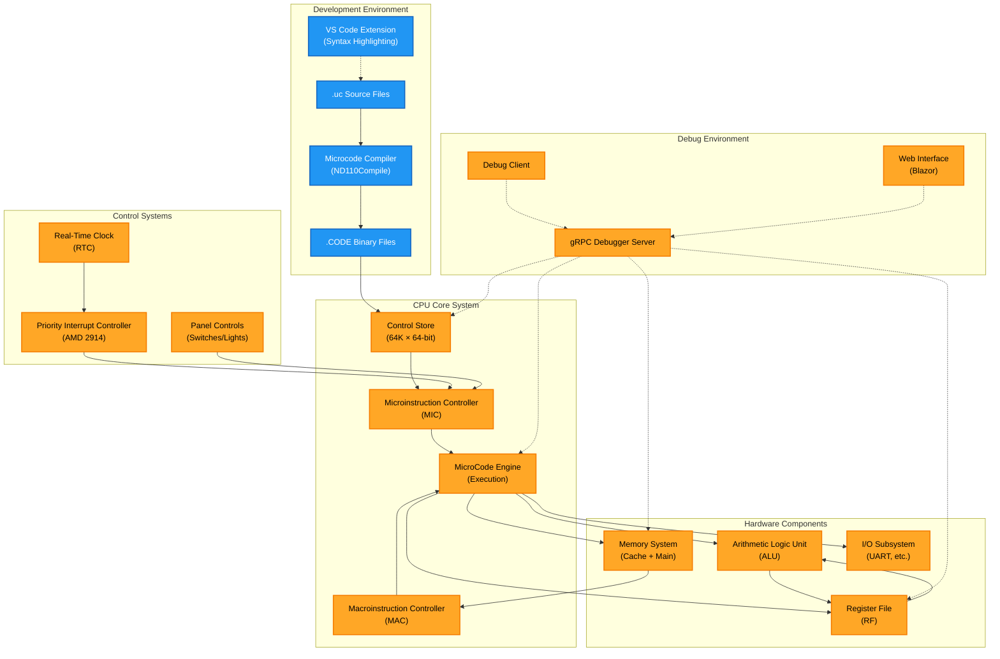
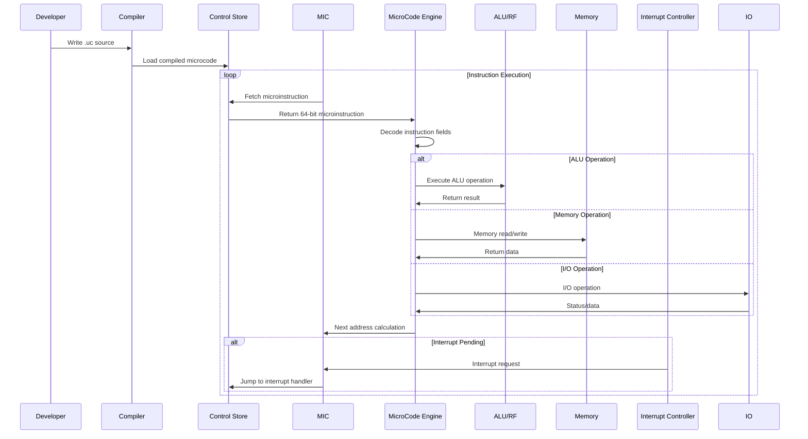
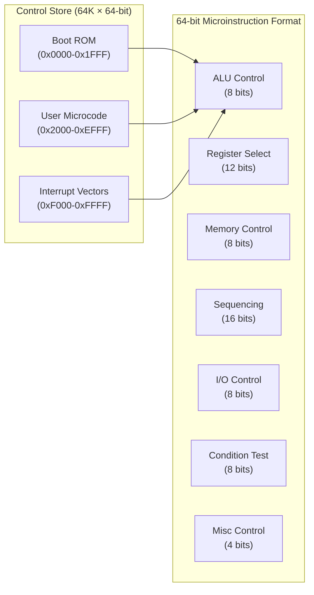
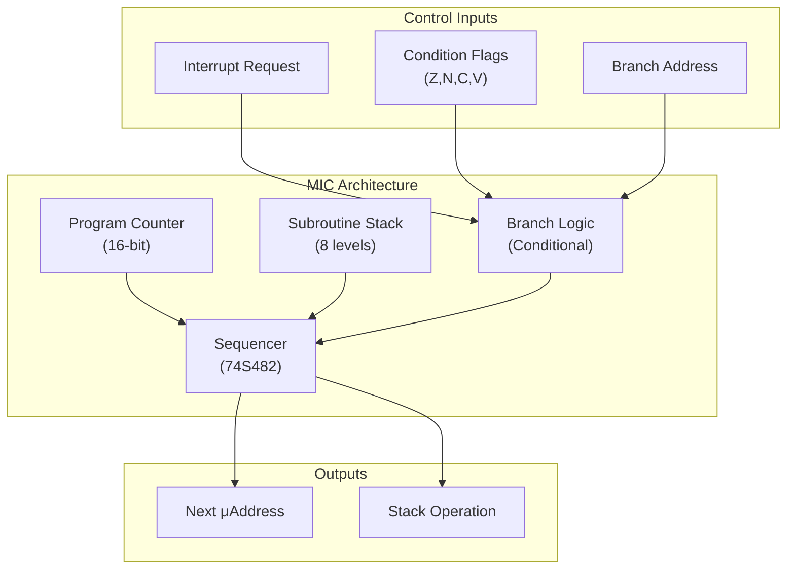
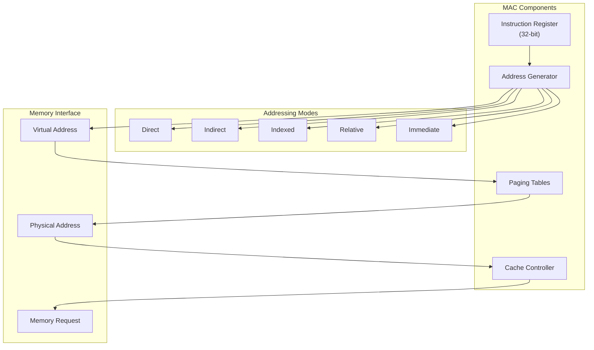

# ND-110/ND-120 Microcode Technical Details

This document contains detailed technical information about the microcode architecture and implementation in the ND-110/ND-120 emulator.

## Microcode Architecture

### Overview

The ND-110 and ND-120 computers use a sophisticated microcode architecture that provides the foundation for instruction execution. The microcode system controls every aspect of CPU operation, from basic arithmetic operations to complex instruction sequencing.

### Component Interaction Diagram



### Data Flow Overview



### Key Components

#### Control Store



- **Capacity**: 64K words of microcode memory
- **Word Size**: 64-bit microinstructions
- **Organization**: Divided into sections for different instruction types
- **Loading**: Microcode is compiled from `.uc` source files and loaded at startup

#### Microinstruction Controller (MIC)



- **Function**: Manages microcode sequencing and branching
- **Sequencing**: Handles conditional and unconditional microcode jumps
- **Stack**: Maintains subroutine call stack for microcode procedures
- **Interrupts**: Interfaces with interrupt handling mechanisms

#### Macroinstruction Controller (MAC)



- **Function**: Handles memory addressing and instruction fetch
- **Addressing Modes**: Supports various ND-110 addressing modes
- **Memory Interface**: Coordinates with memory management unit
- **Cache Integration**: Works with CPU cache for performance

### Microcode Execution Pipeline

The ND-110/ND-120 uses a 4-phase microcode execution model:

1. **Fetch Phase**: Retrieve microinstruction from control store
2. **Decode Phase**: Parse microinstruction fields and prepare execution
3. **Execute Phase**: Perform specified operations (ALU, memory, I/O)
4. **Next Phase**: Determine next microinstruction address

### Microinstruction Format

The 64-bit microinstruction format includes fields for:

- **ALU Control**: Arithmetic and logic unit operation selection
- **Register Selection**: Source and destination register specification
- **Memory Control**: Memory read/write operations
- **Sequencing**: Next address calculation and branching
- **I/O Control**: Peripheral device interaction
- **Condition Testing**: Status flag evaluation for conditional operations

## Development Environment

### Microcode Compiler

The ND110Compile project provides a complete microcode development environment:

#### Features
- **Symbol Resolution**: Support for labels and symbolic constants
- **Macro Support**: Reusable microcode sequences
- **Error Checking**: Comprehensive syntax and semantic validation
- **Optimization**: Basic microcode optimization passes
- **Listing Generation**: Detailed assembly listings with cross-references

#### Source File Format
- **Extension**: `.uc` for microcode source files
- **Syntax**: Assembly-like syntax with ND-specific mnemonics
- **Comments**: C-style comments (`//` and `/* */`)
- **Directives**: Assembler directives for control and data definition

#### Compilation Process
1. **Lexical Analysis**: Tokenize source code
2. **Syntax Parsing**: Build abstract syntax tree
3. **Symbol Resolution**: Resolve labels and references
4. **Code Generation**: Generate binary microcode
5. **Optimization**: Apply optimization passes
6. **Output**: Produce `.CODE` binary files

### VS Code Extension

A dedicated VS Code extension provides:

- **Syntax Highlighting**: Color-coded microcode syntax
- **IntelliSense**: Auto-completion for mnemonics and registers
- **Error Highlighting**: Real-time syntax error detection
- **Debugging Support**: Integration with emulator debugger
- **Build Integration**: Direct compilation from editor

#### Installation
```bash
# Build the extension
./buildext.bat

# Install in VS Code
code --install-extension nd-110-microcode-0.0.1.vsix
```

## Microcode Instruction Set

### ALU Operations
- **Arithmetic**: ADD, SUB, MUL, DIV with various data types
- **Logic**: AND, OR, XOR, NOT operations
- **Shift/Rotate**: Left/right shifts and rotations
- **Compare**: Comparison operations with flag setting

### Register Operations
- **Load/Store**: Register file manipulation
- **Transfer**: Inter-register data movement
- **Stack**: Stack pointer manipulation
- **Special**: Access to special-purpose registers

### Memory Operations
- **Read/Write**: Direct memory access
- **Addressing**: Various addressing mode support
- **Caching**: Cache-aware memory operations
- **Paging**: Virtual memory management

### Control Flow
- **Branches**: Conditional and unconditional jumps
- **Subroutines**: Call/return mechanisms
- **Interrupts**: Interrupt entry and exit
- **Traps**: Exception handling

### I/O Operations
- **Device Access**: Peripheral device communication
- **DMA**: Direct memory access control
- **Interrupts**: I/O interrupt handling
- **Status**: Device status monitoring

## Advanced Features

### Interrupt Handling

The microcode system includes sophisticated interrupt handling:

#### Priority Interrupt Controller (PIC)
- **Type**: AMD 2914-based implementation
- **Levels**: Multiple interrupt priority levels
- **Masking**: Programmable interrupt masking
- **Vectoring**: Automatic vector generation

#### Interrupt Processing
1. **Recognition**: Interrupt signal detection
2. **Priority**: Priority level determination
3. **Masking**: Mask level checking
4. **Vector**: Interrupt vector calculation
5. **Context**: Register context saving
6. **Service**: Jump to interrupt service routine

### Trap Mechanisms

Traps provide exception handling for:
- **Arithmetic Errors**: Overflow, underflow, divide by zero
- **Memory Errors**: Page faults, protection violations
- **Instruction Errors**: Illegal opcodes, privilege violations
- **System Errors**: Hardware failures, timeout conditions

### Timing and Synchronization

The microcode system provides precise timing control:

#### Clock Phases
- **Master Clock**: System timing reference
- **Phase Generation**: Multi-phase clock generation
- **Synchronization**: Inter-component synchronization
- **Delay Control**: Programmable delay insertion

#### Real-Time Features
- **Timers**: Programmable interval timers
- **Counters**: Event counting mechanisms
- **Watchdog**: System watchdog timer
- **Scheduling**: Task scheduling support

## Performance Optimization

### Microcode Optimization

The compiler includes several optimization passes:

#### Instruction Scheduling
- **Pipeline Optimization**: Minimize pipeline stalls
- **Resource Allocation**: Efficient resource utilization
- **Dependency Analysis**: Data dependency optimization
- **Branch Optimization**: Branch prediction and optimization

#### Code Size Optimization
- **Dead Code Elimination**: Remove unused code
- **Common Subexpression**: Eliminate redundant calculations
- **Loop Optimization**: Optimize loop structures
- **Inline Expansion**: Strategic subroutine inlining

### Runtime Performance

The emulator provides several performance features:

#### Caching
- **Instruction Cache**: Microcode instruction caching
- **Data Cache**: Data access caching
- **Translation Cache**: Address translation caching
- **Branch Cache**: Branch target caching

#### Profiling
- **Execution Profiling**: Microcode execution profiling
- **Performance Counters**: Hardware performance counters
- **Trace Generation**: Execution trace capture
- **Bottleneck Analysis**: Performance bottleneck identification

## Debugging and Analysis

### Debugger Integration

The gRPC-based debugger provides comprehensive debugging support:

#### Breakpoints
- **Microcode Breakpoints**: Break on specific microinstructions
- **Address Breakpoints**: Break on memory access
- **Conditional Breakpoints**: Conditional break conditions
- **Watchpoints**: Data modification monitoring

#### Inspection
- **Register Inspection**: View register contents
- **Memory Inspection**: Examine memory contents
- **Stack Inspection**: Stack frame analysis
- **Variable Inspection**: Symbol-based inspection

#### Control
- **Single Stepping**: Step-by-step execution
- **Continue/Stop**: Execution control
- **Reset**: System reset capabilities
- **Profiling**: Performance profiling control

### Interactive Microcode CLI (ND110Cli)

The `ND110Cli` project is an interactive console for hands-on microcode exploration on
the emulated CPU, complementing the gRPC debugger. It works directly on the loaded
control store (DELILAH for ND-110, DELILAH-L for ND-120) and adds a pseudo-C
("english") renderer that translates any 64-bit microcode word into readable C-like
operations (IDB source, ALU operation, command, branching), with symbol-table support
for labelled jump targets.

Capabilities:

- **Boot**: master clear + CPU self-test to the first macro FETCH (reports the STERR
  error code if the self-test fails)
- **Microcode stepping**: single micro-step (`s`), run to next macro FETCH (`s!`)
- **Microcode breakpoints**: `bp` / `!bp` / `bplist` / `bpclear` on control-store
  addresses, honoured by `s!`
- **Single-instruction execution**: `runi <opcode> [REG=val ...]` — presets registers,
  plants the opcode at P, runs exactly ONE macro instruction, reports the registers
- **Traced execution**: `runit <opcode> [REG=val ...]` — same, but lists EVERY microcode
  step with its CS address, pseudo-C, and the actual IDB value + register changes
- **Pseudo-C display**: `-` / `pseudo [addr]` for any control-store word,
  `list <start> [count]` for a range, `,` for raw field decoding
- **Register/memory access**: `reg read/write`, `mem read/write`, `regdump`

```powershell
dotnet run --project ND110Cli            # ND-120 / DELILAH-L
dotnet run --project ND110Cli -- --nd110 # ND-110
```

See [the ndmicrocli README](https://github.com/RetroCoreLabs/NDMicroCpu/blob/main/src/NDMicroCpu.Cli/README.md) for the full command reference, examples,
and architecture notes.

### Trace and Logging

Comprehensive tracing and logging facilities:

#### Execution Tracing
- **Instruction Trace**: Microinstruction execution trace
- **Memory Trace**: Memory access tracing
- **I/O Trace**: I/O operation tracing
- **Interrupt Trace**: Interrupt processing trace

#### Logging Levels
- **Debug**: Detailed debug information
- **Info**: Informational messages
- **Warning**: Warning conditions
- **Error**: Error conditions
- **Fatal**: Fatal error conditions

## Reference Documentation

### Microcode Mnemonics

For a complete list of microcode mnemonics and their syntax, see the compiler source code in `ND110Compile/Compiler.cs` and token definitions in `ND110Compile/ND110Tokens.cs`.

### Register Definitions

CPU registers and their microcode access methods are defined in `ND110CPU/Enums.cs` and documented in the CPU implementation files.

### Instruction Encoding

Binary instruction encoding details can be found in the control store implementation and the microcode execution engine in `ND110CPU/MicroCode.cs`.

### Historical References

This implementation is based on the official Norsk Data documentation:
- ND-110 and ND-120 Microprogrammer's Guide
- ND-110 Microprogram Listing (32-bit version)
- AMD 2914 Priority Interrupt Controller specifications

For the complete historical documentation, see the [Documentation section](https://github.com/RetroCoreLabs/NDMicroCpu#documentation) in the main README.