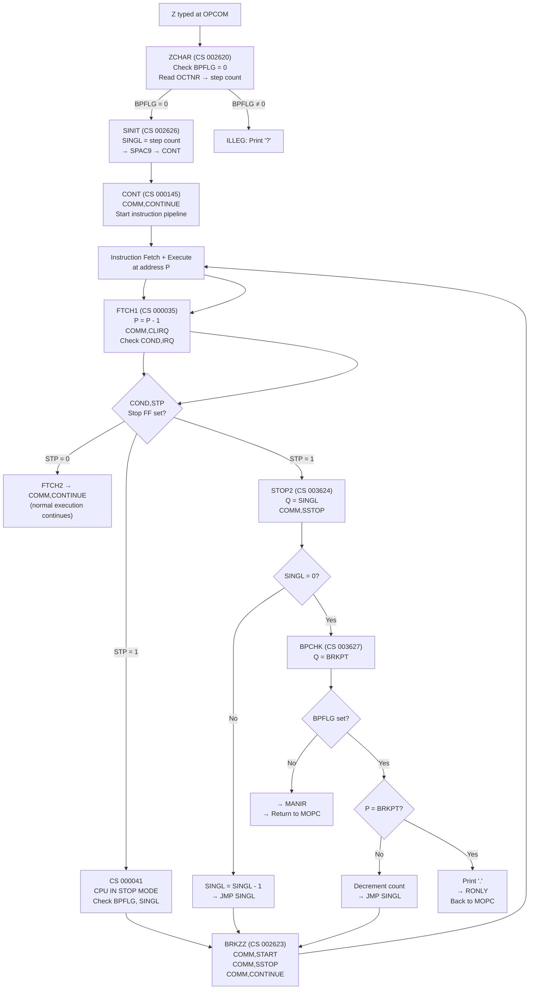
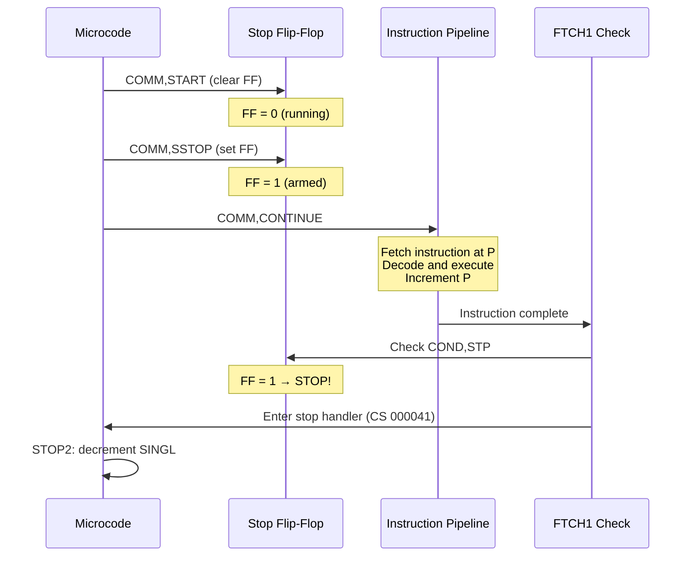
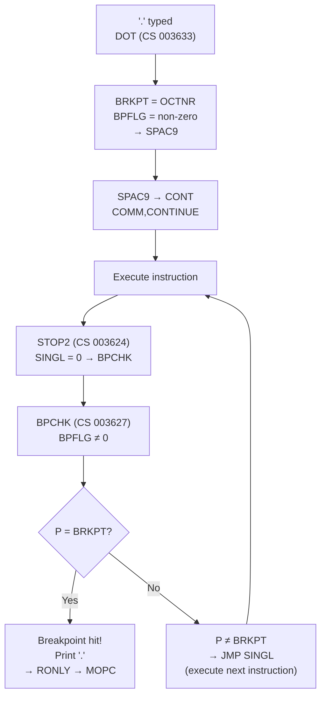

# ND-110 Single Step Microcode Mechanism

How the ND-110 CPU executes exactly one macro-instruction at a time, derived from microcode analysis of `ND-110-RASK.LISTING.TXT`.

## Overview

The single-step mechanism uses three hardware control commands and a stop flip-flop. The microcode issues `START`, `SSTOP`, `CONTINUE` in rapid succession — this creates a one-instruction gate that lets exactly one macro-instruction through before the CPU re-enters stop mode.

The same mechanism is used for:
- **Z command** (single step N instructions)
- **Breakpoint execution** (`.` command — run until P matches address)
- **Page fault/protect violation recovery** while in stop mode

## The Three Hardware Commands

| Command | Microcode | What It Does |
|---------|-----------|-------------|
| `COMM,START` | Clears stop flip-flop | CPU is "running" — `COMM,CONTINUE` can now fetch an instruction |
| `COMM,SSTOP` | Sets stop flip-flop | CPU is "stopped" — but only checked AFTER the current instruction completes |
| `COMM,CONTINUE` | Starts instruction fetch | Fetches instruction at P, decodes, executes, increments P, returns to interrupt check |

**Key insight**: `COMM,SSTOP` does not stop the CPU immediately. It arms a flip-flop that is checked at FTCH1 (CS 000035) after the instruction completes. So the sequence START → SSTOP → CONTINUE executes exactly one instruction.

## Microcode Registers

| Register | Purpose |
|----------|---------|
| `SINGL` | Step counter. Decremented after each instruction. When 0, CPU stays stopped. |
| `BPFLG` | Breakpoint flag. Non-zero = breakpoint mode active. |
| `BRKPT` | Breakpoint address. Compared against P after each instruction. |
| `MANIR` | Manual instruction flag. Non-zero = execute instruction from BRKPT register. |

## Complete Flow

### Phase 1: Z Command Input (ZCHAR → SINIT)

```
ZCHAR (CS 002620):
  1. Read BPFLG — if non-zero, print '?' (Z illegal when breakpoint active)
  2. Read OCTNR — step count (default 1 if no number typed)

SINIT (CS 002626):
  3. SINGL = OCTNR (store step count in register file)
  4. → SPAC9 → CONT (return to MOPC main loop)
```

### Phase 2: CONT Starts the Pipeline

```
CONT (CS 000145):
  Z = 0                    — Clear Z register
  COMM,CONTINUE            — Start instruction fetch pipeline
```

### Phase 3: Instruction Executes, Stop FF Checked at FTCH1

After the instruction completes, the microcode reaches the interrupt check:

```
FTCH1 (CS 000035):
  P = P - 1               — Undo auto-increment
  COMM,CLIRQ              — Clear interrupt request
  Check COND,IRQ           — Pending interrupt?

  If interrupt pending:
    Check COND,STP         — Is stop flip-flop set?

    STP = 1 (set):  → CS 000041 (stop mode handler)
    STP = 0 (clear): → FTCH2 → COMM,CONTINUE (next instruction)
```

### Phase 4: Stop Mode Handler — Dispatch

```
CS 000041: "CPU IS IN STOP MODE"
  1. Read BPFLG — check breakpoint flag
     BPFLG ≠ 0: check SINGL
     BPFLG = 0: also check SINGL

  2. Read SINGL — check step count
     SINGL ≠ 0: → BRKZZ (execute another instruction)
     SINGL = 0: → BRKZZ (but STOP2 will detect count=0 and stop)
```

### Phase 5: BRKZZ — Execute One Instruction

```
BRKZZ / SINGL (CS 002623):
  COMM,START               — Clear stop FF (allow CONTINUE to work)
  COMM,SSTOP               — Re-arm stop FF (will fire AFTER next instruction)

  (CS 002625):
  Z = 0
  COMM,CONTINUE            — Fetch and execute ONE instruction
```

The three commands in sequence:
1. **START** — clears stop FF so the pipeline can run
2. **SSTOP** — immediately re-arms it (checked after instruction completes)
3. **CONTINUE** — fetches and executes one instruction

### Phase 6: STOP2 — Decrement Counter

After the instruction completes and the stop handler is re-entered:

```
STOP2 (CS 003624):
  1. Q = SINGL, COMM,SSTOP — Read counter, re-arm stop
     Check F=0: is SINGL = 0?

  SINGL > 0:
    2. SINGL = SINGL - 1   — Decrement counter
    3. → JMP SINGL          — Execute another instruction (back to Phase 5)

  SINGL = 0:
    2. Read BPFLG           — Check breakpoint
    3. → JMP BPCHK          — Breakpoint check
```

### Phase 7: BPCHK — Breakpoint Check

```
BPCHK (CS 003627):
  1. Q = BRKPT             — Read breakpoint address

  BPFLG = 0 (no breakpoint):
    → MANIR (check manual instruction, then return to MOPC)

  BPFLG ≠ 0 (breakpoint active):
    2. Compare Q - P        — Is P at breakpoint address?

    P ≠ BRKPT:
      3. Decrement count, → JMP SINGL (keep running)

    P = BRKPT (hit!):
      3. PRCHR = '.'        — Print breakpoint character
      4. → RONLY             — Return to MOPC (deposit not allowed)
```

## Flow Diagram



## The Stop Flip-Flop Gate

The heart of single stepping is the START/SSTOP/CONTINUE sequence at BRKZZ (CS 002623-002625):



The key: SSTOP is armed **before** CONTINUE runs the instruction. After that one instruction completes, FTCH1 sees the stop FF and enters the stop handler. The instruction pipeline never gets a chance to fetch a second instruction.

## Breakpoint Execution Flow

The `.` (DOT) command uses the same BRKZZ mechanism but with BPFLG set:



With breakpoints, the loop runs continuously (SINGL stays at 0, but BPCHK sends it back to SINGL/BRKZZ for another instruction) until P matches BRKPT or the operator types a non-alphanumeric character to abort.

## Panel Single Button

The physical SINGLE button on the operator panel enters via interrupt vector SING2 (CS 002627):

```
SING2 (CS 002627):
  Check COND,STP            — Only legal in STOP mode

  STP = 1 (stopped):
    → JMP SINGL             — Execute one instruction (SINGL counter ignored)

  STP = 0 (running):
    → JMP CONT              — Ignore (CPU not stopped)
```

The panel button bypasses the counter — it always executes exactly one instruction.

## Interaction with Page Faults

The comment at CS 002623 says: **"ALSO ENTERED FROM PAGE FAULTS & PROT.VIOLS. WHEN IN STOP"**

When the CPU is in stop mode and a page fault or protect violation occurs (e.g., during a single-stepped instruction that touches a faulted page), the trap handler at PVPF (CS 000027) processes the fault, and then the stop-mode handler re-enters BRKZZ to retry the faulted instruction. This means page faults are handled transparently during single stepping — the operator sees one successful instruction execution even if it required a page fault to be resolved first.

## Summary

| Component | CS Address | Role |
|-----------|-----------|------|
| ZCHAR | 002620 | Z command entry: check BPFLG, read step count |
| SINIT | 002626 | Store step count in SINGL register |
| SINGL/BRKZZ | 002623 | The gate: START → SSTOP → CONTINUE (one instruction) |
| FTCH1 | 000035 | Post-instruction check: COND,STP detects stop FF |
| CS 000041 | 000041 | Stop mode handler: dispatch to BRKZZ if SINGL/BPFLG set |
| STOP2 | 003624 | Post-instruction: decrement SINGL, check counter |
| BPCHK | 003627 | Breakpoint check: compare P against BRKPT |
| CONT | 000145 | Normal continue: COMM,CONTINUE resumes pipeline |
| SING2 | 002627 | Panel button: single step without counter |
| DOT | 003633 | Set breakpoint: BRKPT = address, BPFLG = active |
